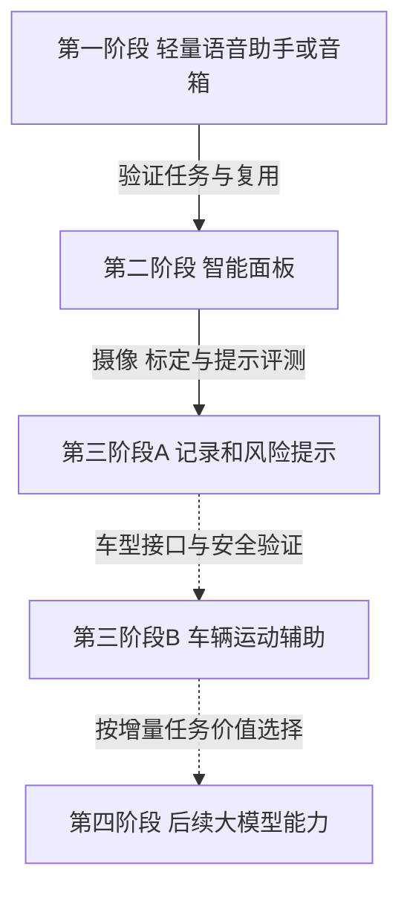
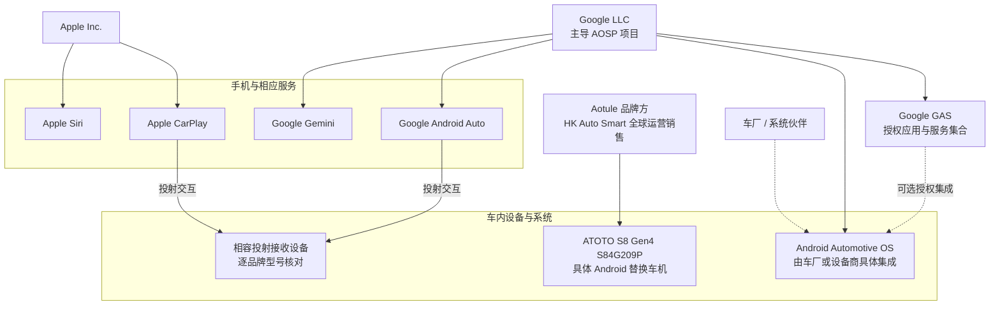
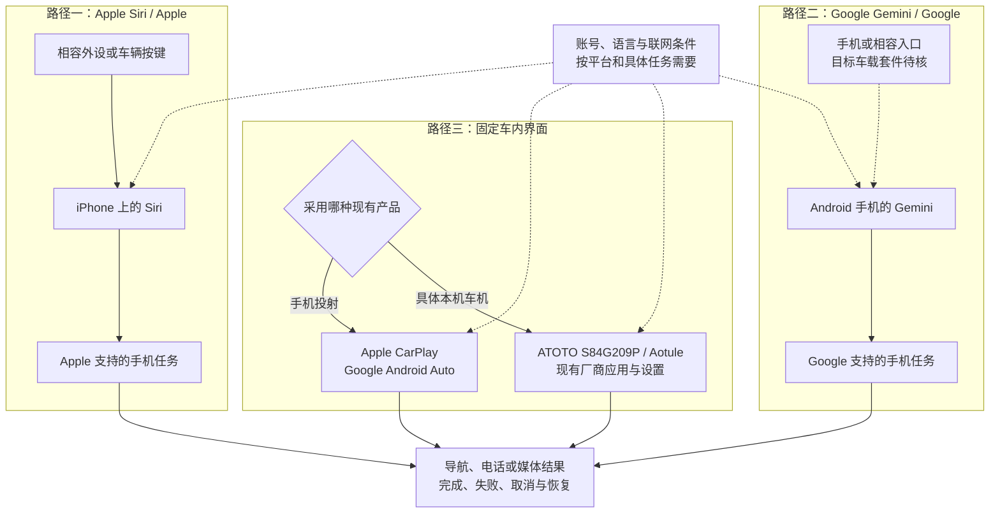
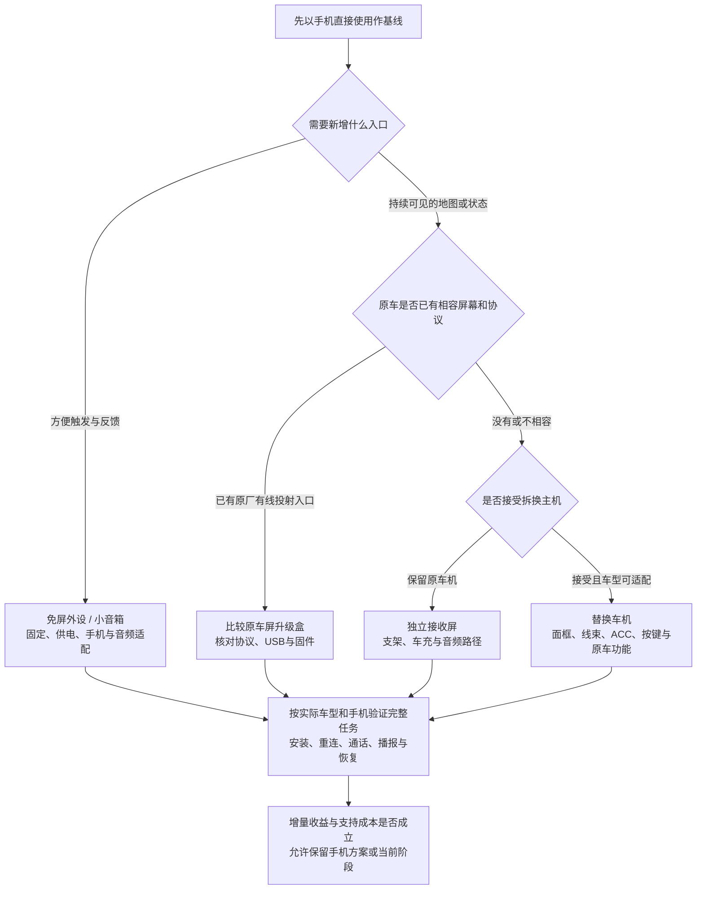
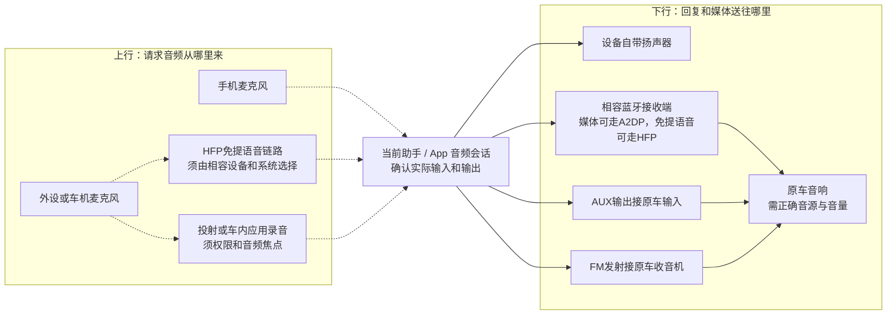
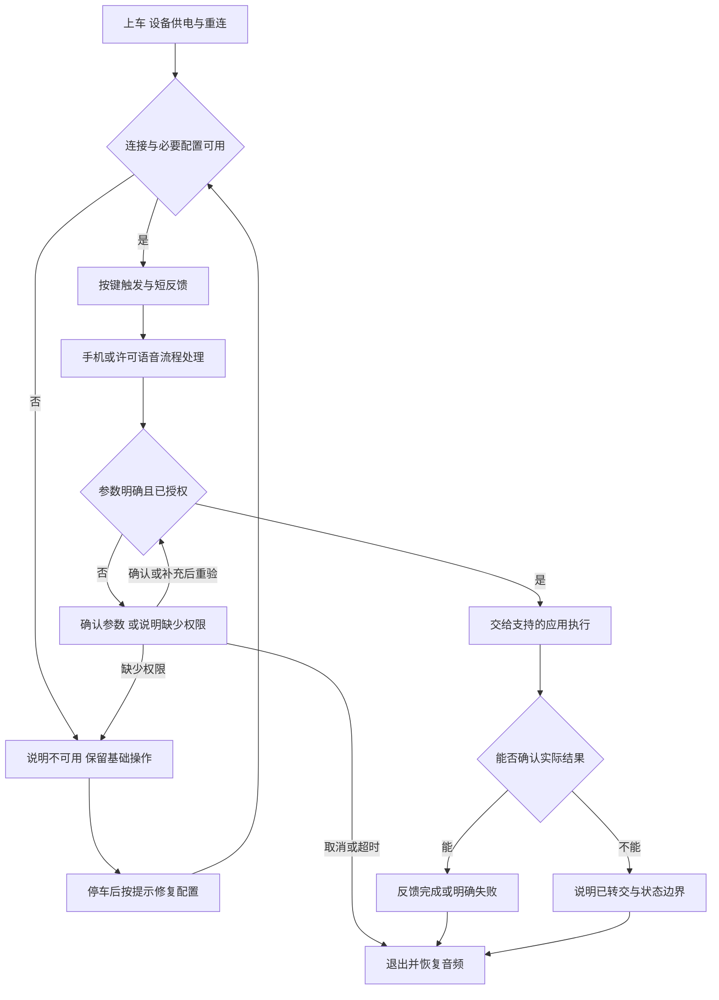
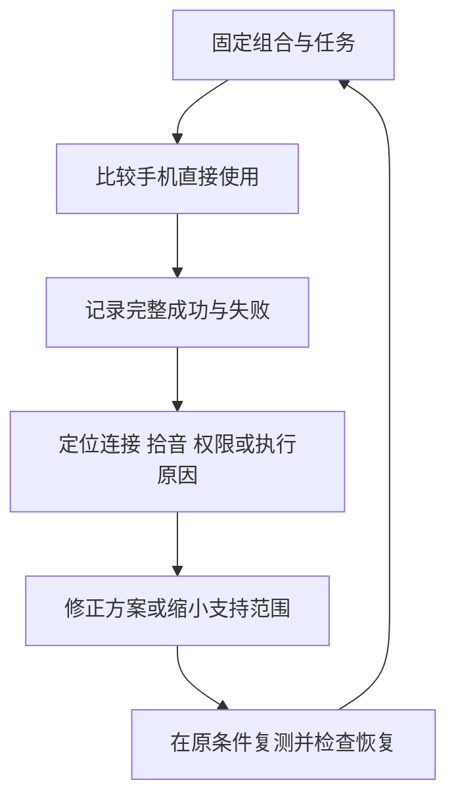
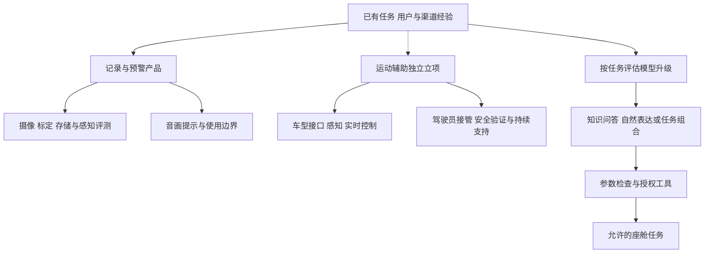

整理日期：2026年11月5日。面向 DreamSoul 的产品与经营判断，以存量燃油车的轻量智能化为起点，研究小型语音外设、智能面板、辅助驾驶及后续大模型能力。资料采用官方产品页、手册、平台文档和原始业务披露的针对性阅读，未进行采购、手机激活或实车测试。

**首款产品可以先是一件免屏、免拆的小外设：让少量车内高频任务更容易完成，语音识别和任务执行允许依赖手机、云服务或固定规则。** 蓝牙免提产品的官网已有当前销售线索，未验证采购交付。其公开价格和功能可作竞争参照。DreamSoul 需要验证的购买理由，是更少配置、更可靠的连接、明确的反馈，或针对某类用户更好完成任务。车内本地大模型可作为后续增量能力，首期价值应能独立成立。

# 一、产品起点与渐进路线
## （一）首款以少操作的任务入口建立购买理由
产品起点是免屏、免拆的小型语音助手或音箱，先让少量车内任务更容易完成。识别和执行可以依赖手机、云服务或固定规则，首款不要求车内运行通用大模型。Avantree CK11、Roadtrip 的官网提供当前价格、库存标签和手机助手入口说明，形成现实比较线索，采购交付尚未验证。这些材料说明已有类似供给，不能证明 DreamSoul 的目标需求或经营结果。[CK11 商品页](https://avantree.com/products/ck11-hands-free-bluetooth-for-car)、[Roadtrip 商品页](https://avantree.com/products/roadtrip-handsfree-bluetooth-speaker-for-cars)

客户先按原车接口和实际困难划分。缺少蓝牙、AUX 的用户可能更需要自带扬声器，已有基础蓝牙的用户可能更需要触发与反馈，已有稳定 CarPlay 或 Android Auto 的用户则已有较完整入口。燃油类型无法代替这种细分。首期可研究“接受手机联网、希望免拆安装、尚无好用车内入口”的用户，但这仍是客群假设，需观察他们已有手机方案的不足。

购买理由应能与手机直接使用比较：上车后是否少配置，按键是否容易找到，能否听到明确结果，断网或来电后是否容易恢复。CK11 官方指南特别说明语音命令使用手机麦克风，因此外设有麦克风并不自动等于改善助手拾音。拾音增量需要在具体手机和设备组合上验证。[CK11 交互指南](https://avantree.com/pages/ck11-interactive-user-guide)

## （二）四阶段分别有目标与进入条件
图中是研究提出的产品扩展方向，第三阶段分为记录预警和车辆运动辅助。各箭头代表需要重新确认的能力与经营条件。

这不是技术上的强制同序。大模型可在前期出现明确需求时独立评估，记录提示也可以成为长期独立产品。前一阶段用户量、售出设备或渠道规模，都不能代替下一阶段的产品和技术证据。

| **扩展关系** | **可复用的资产** | **必须新增或重新验证** | **推进依据** |
|---|---|---|---|
| 轻量助手到面板 | 已验证任务、确认与取消规则、部分音频适配、客户问题和支持经验 | 显示交互、安装供电、系统与固件、触控回退。投射屏的具体品牌型号与平台功能另核 | 固定地图、状态或确认确有增量价值，安装和售后负担可承担 |
| 面板到记录预警 | 适用的显示、电源、固定方式及渠道流程 | 摄像头位置、标定、视频存储、感知与误报漏报、数据管理 | 目标场景的记录或提示价值成立，限制能被理解 |
| 记录预警到运动辅助 | 经确认适用的安装、设备管理和服务流程 | 车型授权接口、实时控制、接管与失效处置、安全团队和持续验证 | 特定车型和功能范围明确，具备专业合作与交付条件 |
| 已有产品到模型能力 | 任务词表、合法知识、工具接口、故障分类和评测样例 | 模型与语音许可、算力或云费、语言评测、不确定输出控制和版本维护 | 相同任务下优于规则或现有助手，增量收益覆盖新增成本 |

复用应落实到具体资产。例如“会做蓝牙音频”只能减少一部分面板接入工作，不能证明已经会做车辆控制。支持数据可以帮助找出高频故障，经授权的道路数据和控制验证仍需另行取得。这一矩阵是工程和经营分析，不代表上述厂商提供了开放接口或合作承诺。

## （三）允许停留、合作和调整方向
每阶段都应回答三个问题：用户为什么购买，产品怎样稳定交付，实际净收入能否承担对应责任。若手机已满足需求，可以调整客群或服务。若面板增量不足，可以继续经营轻量外设。若进入驾驶辅助，专业合作可能比全部自研更合适。区域市场也按同一方法核验，波兰仅作客群、渠道、语言和交付条件待核的案例。

本研究不预设销量、BOM、期限或融资额。推进依据应来自实际任务完成、用户复用、供应报价、支持负担和现金需求，不能仅由路线图或旧车存量推导。

# 二、平台与载体
比较对象直接采用现有平台名和具体产品型号，并列明对应公司。Apple Siri、Google Gemini是手机助手；Apple CarPlay、Google Android Auto是手机互联平台；AAOS是Google主导的AOSP汽车系统基座；GAS是Google授权服务。ATOTO S84G209P则是具体后装车机，不代表整个Android后装市场。以下均为公开资料判断，未进行手机或实车测试。

## （一）现有平台与产品适配评分
<!-- score-summary:start -->
评分对象全部为现有平台或具体产品。公司和平台对应关系可直接追到官方资料；分数针对本项目采用现成方案的适配度，非平台性能排名。

| **平台 / 具体型号** | **公司** | **无屏助手** | **智能面板** |
|---|---|---:|---:|
| Apple CarPlay | Apple | 64 | 74 |
| Google Android Auto | Google | 64 | 74 |
| AAOS（AOSP） | Google | 34 | 44 |
| Google GAS | Google | — | — |
| Apple Siri | Apple | 88 | 66 |
| Google Gemini | Google | 70 | 63 |
| ATOTO S84G209P | Aotule | 54 | 66 |

五维依次为部署匹配、任务复用、可配置性、接入可得、维护易度；可配置性只计已有设置、偏好与厂商支持入口。首期权重30/30/10/20/10%，面板期20/20/25/20/15%。总分＝100×各维分数与权重乘积之和÷(5×权重总和)。分差不超过5分按同档理解，未知不填0，GAS服务层不独立计总分。

新分值按采用现成方案重审，不预设本项目已有手机软件或系统集成权。Siri需支持的手机、语言和外设；Gemini通用车载蓝牙按钮兼容未证；ATOTO S84G209P为双DIN拆装车机。原分、逐维理由、公司主体与直接来源见 [评分与市场数据](<车载智能化 评分与市场.json>)。

<!-- score-summary:end -->

## （二）现有平台横向对比
比较共同任务：在传统车辆上使用导航、通话、媒体与简单语音入口。公司字段表示品牌、产品发行或项目主导方，实际地区服务合同与销售主体仍按相应条款核对；不同层次的对象可以组合，不是七套可互换的操作系统。

### 使用能力
名称链接指向对应平台或型号，公司链接指向官方主体依据。离线按具体任务、设备与语言核查。

| **平台 / 方案** | **主要任务与入口** | **应用在哪里运行** | **手机与屏幕条件** | **离线范围** |
|---|---|---|---|---|
| [Apple CarPlay](https://developer.apple.com/carplay/) [Apple](https://www.apple.com/legal/intellectual-property/trademark/appletmlist.html) 手机投射 | iPhone导航、音频、电话、消息；Siri及车内控件 | iPhone应用与Apple车内交互框架 | 相容iPhone与CarPlay接收设备；有线/无线按机型 | 地图、下载内容和Siri任务分别核，不保证整链离线 |
| [Google Android Auto](https://developer.android.com/training/cars/platforms/android-auto) [Google](https://play.google.com/store/apps/details?id=com.google.android.projection.gearhead&hl=en) 手机投射 | 相容导航、媒体、通信；支持的车内语音入口 | 以Android手机应用服务提供车内界面 | 受支持Android手机与接收设备；当前要求按组合核对 | 按App和助手任务核查；数据套餐条件不等于本机离线系统 |
| [Android Automotive OS](https://source.android.com/docs/automotive/start/what_automotive) [Google / AOSP](https://source.android.com/docs/setup/about) 车内系统基座 | 本机应用、音频与车内系统整合；服务需集成 | 车内硬件；由车厂或设备商形成具体系统 | 本机运行不靠手机投射；通信等另核 | 取决于安装的地图、语音和执行组件 |
| [Google GAS / Google built-in](https://source.android.com/docs/automotive/start/what_automotive) [Google](https://developers.google.com/cars) 服务层与集成体验 | 获授权的Google地图、应用及车载服务 | GAS为服务集合，Google built-in为集成体验 | 依赖相应车内系统；通话、短信按官方流程配对手机 | 部分Assistant任务、预下载地图可离线；不外推全部Gemini会话 |
| [ATOTO S8 Gen4 S84G209P](https://www.atotodirect.com/de-us/products/atoto-s84g209p-9inch-double-din-car-stereo-eu) [Aotule](https://www.atotodirect.com/en-gb/pages/about-atoto) 具体后装车机 | 本机导航、媒体、DriveChat及CarPlay/Android Auto | 该型号的Android 13 / AICE UI 13系统 | 双DIN拆装及线束适配；投射需手机，DriveChat设置用厂商SSHub | 收音机/本地媒体按功能；DriveChat明确需联网 |
| [Apple Siri](https://support.apple.com/en-ie/guide/iphone/iph0aa8c80e6/27/ios/27) [Apple](https://www.apple.com/legal/intellectual-property/trademark/appletmlist.html) 现有手机助手 | Apple支持的电话、导航、媒体等语音任务 | iPhone与Apple相关服务 | 相容iPhone、语言和设置；具体按键及拾音另核 | 受设备、语言与任务限制，不等于完整离线助手 |
| [Google Gemini](https://support.google.com/gemini/answer/14554984?hl=en) [Google](https://play.google.com/store/apps/details?id=com.google.android.apps.bard&hl=en) 现有手机助手 | Google支持的问答及通信、地图、媒体任务 | Android手机与Google服务 | 需相容手机、Google官方软件/默认助手设置；目标车载外设待核 | 相容外设方案有联网要求；不据蓝牙连接推导离线 |

### 接入、责任与采用条件
这里分别核查现成使用入口、平台公开开发规则和设备接口，不能从“可安装应用”推导已取得系统或车辆控制权。

| **平台 / 方案** | **应用与硬件接入** | **车辆权限边界** | **费用与交付责任** | **采用判断** |
|---|---|---|---|---|
| [Apple CarPlay](https://developer.apple.com/carplay/) [Apple](https://www.apple.com/legal/intellectual-property/trademark/appletmlist.html) 手机投射 | 使用相容接收设备和已有iPhone应用；新增App类别授权与MFi接收硬件是不同路径 | 普通CarPlay不提供任意车控；车厂集成另核 | 接收设备、手机、内容与相关许可分别计 | 面板阶段的iPhone生态基线 |
| [Google Android Auto](https://developer.android.com/training/cars/platforms/android-auto) [Google](https://play.google.com/store/apps/details?id=com.google.android.projection.gearhead&hl=en) 手机投射 | 使用相容接收设备和受支持手机应用；类别、质量与分发规则明确 | 部分车况读取依API、权限和车型；不等于通用控制 | 设备、手机、数据、内容和兼容支持另计 | 面板阶段的Android生态基线 |
| [Android Automotive OS](https://source.android.com/docs/automotive/start/what_automotive) [Google / AOSP](https://source.android.com/docs/setup/about) 车内系统基座 | 采用已有AAOS具体系统需核车厂/设备商服务与配置 | VHAL与系统特权由具体实现及授权决定 | AOSP代码基座开放；整机、移植、维护和服务不自动免费 | 先找明确系统伙伴，不当作零售车机 |
| [Google GAS / Google built-in](https://source.android.com/docs/automotive/start/what_automotive) [Google](https://developers.google.com/cars) 服务层与集成体验 | GAS由汽车OEM选择授权；不是给任意旧车下载的完整套件 | Google服务许可不等于全部车厂权限 | 具体商业许可和车型服务套餐待核 | 关联服务项，不独立计总分 |
| [ATOTO S8 Gen4 S84G209P](https://www.atotodirect.com/de-us/products/atoto-s84g209p-9inch-double-din-car-stereo-eu) [Aotule](https://www.atotodirect.com/en-gb/pages/about-atoto) 具体后装车机 | 现有FindApps、ZLINK、DriveChat/SSHub；公开第三方SDK/API未核得 | 已公开摄像头与按键适配，不等于开放底盘控制 | 整机、线束/面框、拆装、可选服务及售后分别核价 | 比较具体车机，先核型号与安装 |
| [Apple Siri](https://support.apple.com/en-ie/guide/iphone/iph0aa8c80e6/27/ios/27) [Apple](https://www.apple.com/legal/intellectual-property/trademark/appletmlist.html) 现有手机助手 | 相容车辆Siri Eyes Free；Roadtrip官方另有调用Siri的旋钮步骤 | 调用手机任务，未因此取得通用车控；助手麦克风路由要验证 | 外设、手机适配与服务条件分别承担 | 首款可验证入口，限定语言与设备 |
| [Google Gemini](https://support.google.com/gemini/answer/14554984?hl=en) [Google](https://play.google.com/store/apps/details?id=com.google.android.apps.bard&hl=en) 现有手机助手 | Google确认相容耳机及Android Auto入口；不能外推所有车载蓝牙套件 | 默认助手及任务权限有条件，不是车辆控制接口 | 官方软件、账号、联网及目标配件兼容另核 | Android候选入口，先验证车载外设 |

Apple对应Apple Inc.。Google Gemini和Android Auto的官方发行者为Google LLC；AAOS由Google主导AOSP、车厂/设备商集成，并非Google独家销售的统一成品。ATOTO官网披露品牌归属**Shenzhen Aotule Technology Co., Ltd.**，其全资子公司**HK Auto Smart Technology Co., Limited**获授权负责全球运营销售；本次未确认S84G209P具体型号的法定制造主体。[Apple商标清单](https://www.apple.com/legal/intellectual-property/trademark/appletmlist.html)、[Gemini发行者](https://play.google.com/store/apps/details?id=com.google.android.apps.bard&hl=en)、[Android Auto发行者](https://play.google.com/store/apps/details?id=com.google.android.projection.gearhead&hl=en)、[AOSP项目说明](https://source.android.com/docs/setup/about)、[ATOTO公司说明](https://www.atotodirect.com/en-gb/pages/about-atoto)

<!-- platform-comparison-cards -->

### 选择落到平台与具体设备
第一阶段按手机系统和支持语言，分别验证Apple Siri、Google Gemini与具体车载外设。Avantree Roadtrip和CK11资料明确写Siri / Google Assistant，不能把旧Google Assistant名称直接替换成已验证的Gemini兼容。[Roadtrip官方说明](https://support.avantree.com/hc/en-us/articles/38121800304793-Roadtrip-How-to-activate-the-voice-assistant-with-the-car-kit-Siri-Google-Assistant)、[CK11官方说明](https://support.avantree.com/hc/en-us/articles/50767188774937-How-to-Make-a-Call-by-Voice-Command)

第二阶段需要固定地图和可见状态时，再按iPhone/Android客群比较CarPlay、Android Auto及明确接收设备；ATOTO S84G209P是本机软件与拆装车机的具体参照。AAOS与GAS用于理解系统集成和服务许可条件。CarPlay Ultra仍是原厂深度集成边界，不能把其车控功能写给普通CarPlay或后装接收屏。

## （三）平台、公司与执行位置
Apple Siri在iPhone及相关服务环境处理请求；Google Gemini需要Google提供的手机软件与相应设置。本课题采用这些既有能力，外设负责相容的触发、固定与音频入口。Google已公开相容耳机的按键/触控入口，以及Gemini in Android Auto的屏幕与方向盘入口；这些证据都不能替代目标车载音箱的兼容测试。[Apple车内Siri](https://support.apple.com/en-ie/guide/iphone/iph0aa8c80e6/27/ios/27)、[Gemini相容耳机](https://support.google.com/gemini/answer/15456140?hl=en)、[Gemini车内条件](https://support.google.com/gemini/answer/16735982?hl=en)

CarPlay与Android Auto把受支持手机应用带到相容车内界面。AAOS则在车内硬件运行，GAS可由汽车OEM另行授权集成。ATOTO S84G209P的Android 13/AICE UI 13与本机软件是具体厂商实现，不能仅凭Android名称认定AAOS或GAS均已具备。图中实线表示平台归属、实现或投射关系，虚线表示需要授权或具体集成的关系，不代表全部车辆数据已开放。

## （四）三种具体接入路径
| **路径** | **现有平台与公司** | **可获得的价值** | **先核什么** |
|---|---|---|---|
| iPhone无屏入口 | Apple Siri / Apple | 复用支持的手机任务 | 配件触发、语言、锁屏与拾音 |
| Android无屏候选 | Google Gemini / Google | 复用Google手机助手 | 目标车载外设兼容与任务差异 |
| 固定车内界面 | CarPlay / Apple；Android Auto / Google；ATOTO S84G209P / Aotule | 地图显示、状态和触控回退 | 接收协议或本机应用、安装及联网 |

它们是现有方案的接入选择。无屏助手不必先获得CarPlay接收端资格；增加屏幕也不会自动得到全部系统权限。图中虚线指明尚待验证的车载外设条件，网络依赖按具体任务判断。

## （五）四类载体与具体产品不同
| **载体** | **已研究例子** | **安装与前提** |
|---|---|---|
| 免屏小外设 | Avantree CK11 / Roadtrip | 固定、供电、手机及音频适配 |
| 独立屏 | Carpuride W903 | 支架、车充、手机与原车音频 |
| 替换车机 | ATOTO S84G209P | 双DIN拆换，面框/线束/ACC与原车功能适配 |
| 原车屏升级盒 | Ottocast P3 Pro / Carlinkit Tbox UHD | 先有相容原车有线投射接口，不能只靠USB口 |

载体是安装分类，不是统一平台。ATOTO手册提醒常电与ACC接错会影响休眠与启动；原车屏升级盒则须逐型号核原车协议及排除项。渠道应先记录车辆现有接口和保留功能，再匹配具体品牌型号。[ATOTO手册](https://www.atotodirect.com/en-gb/pages/manual-460-en)、[Carlinkit条件](https://www.carlinkit.com/uhd6225)、[W903官网](https://carpuride.com/products/carpuride-w903-portable-smart-multimedia-dashboard-console-with-front-camera)

## （六）音乐播放与助手拾音分开验证
手机、外设和原车可能各有麦克风。按下设备按钮不证明Apple Siri或Google Gemini使用了外设麦克风；CK11官方排查要求手机靠近且手机麦克风无遮挡，是具体型号的反例。[CK11语音指南](https://support.avantree.com/hc/en-us/articles/50767188774937-How-to-Make-a-Call-by-Voice-Command)

| **链路** | **主要作用** | **还需核实** |
|---|---|---|
| HFP | 免提语音与电话相关控制 | 助手是否选用外设麦克风 |
| A2DP | 媒体音频播放 | 不提供反向录音保证 |
| AUX | 模拟声音送入原车音响 | 不读取原车麦克风 |
| FM | 将声音送入收音机 | 拾音、音源切换及频点干扰 |

上述职责依据[Bluetooth HFP简介](https://www.bluetooth.com/specifications/specs/hands-free-profile-1-10/)及[Android蓝牙配置](https://developer.android.com/develop/connectivity/bluetooth/profiles)。来电、音乐、导航和助手会改变音频焦点，应用录音也有权限与失焦停止条件。应在具体Apple/Google手机、固件和设备组合上验证完整任务与恢复。[Google车载麦克风](https://developer.android.com/training/cars/apps/library/car-microphone)

## （七）平台许可与设备合作分别核对
Apple管理CarPlay类别与框架；Google管理Android Auto支持类别、分发和Google服务；设备商负责具体固件、驱动和配件；车厂决定相应原厂车辆接口。平台代理、应用安装和系统集成不是同一权限。

CarPlay接收硬件涉及MFi；仅使用iOS支持的标准蓝牙配置的配件，不自动套用相同MFi要求。ATOTO现有FindApps、ZLINK、DriveChat/SSHub说明了厂商提供的功能，不证明第三方已取得其公开SDK或全部系统权限。[MFi FAQ](https://mfi.apple.com/en/faqs)、[ATOTO手册](https://www.atotodirect.com/en-gb/pages/manual-460-en)

AAOS的VHAL由具体系统/车厂实现，部分特权需要系统预装和授予；Android Auto也有受条件约束的部分车况读取API。上述均不能推广为通用车辆写入、转向或制动接口。[VHAL](https://source.android.com/docs/automotive/vhal)、[AAOS集成](https://source.android.com/docs/automotive/voice/voice_interaction_guide/integration_flows)、[车况API](https://developer.android.com/training/cars/apps/library/car-hardware-api)

## （八）首款与面板分别验证
首款先选择明确的Apple Siri或Google Gemini手机环境、具体外设和一种音频组合，与手机直接使用比较任务成功、重试、需看手机次数及支持成本。目标语言须在平台支持范围内；界面能显示波兰语，不证明Siri已支持该语言的语音任务。[Apple功能清单](https://www.apple.com/ios/feature-availability/)

用户确需固定显示时，再选择相容CarPlay/Android Auto接收设备或ATOTO S84G209P等明确本机产品。依次验证安装、供电、连接、现有应用和软件更新，不由增加屏幕或设备销量推导后续驾驶辅助能力。

# 三、按阶段竞品比较
## （一）首期直接竞品与历史经验
以下价格均保留时间、地区和具体型号。当前商品页有库存标识仅说明可见销售状态，尚未下单确认交付，不能作为波兰含税、运费和售后的套餐报价。

| **产品与阶段** | **能力和依赖** | **价格及状态** | **对产品判断的价值** |
|---|---|---|---|
| Avantree CK11，小型免提音箱 | 遮阳板夹装、自带扬声器、手机蓝牙和手机助手 | 官网 titanium 当前 US$44.99，标 In Stock | 是免拆首款的直接参照。官方指南明确语音命令使用手机麦克风，不能据设备有麦克风宣传已改善助手拾音。[CK11 商品页](https://avantree.com/products/ck11-hands-free-bluetooth-for-car)、[CK11 指南](https://avantree.com/pages/ck11-interactive-user-guide) |
| Avantree Roadtrip，小音箱与 FM | 自带扬声器，支持将手机音频送入收音机，长按旋钮两秒调用手机助手 | 官网当前 US$64.99，标 In Stock | 通过安装、音频和操作入口形成价值。助手说明仍要求手机助手启用、蓝牙和网络条件。[Roadtrip 商品页](https://avantree.com/products/roadtrip-handsfree-bluetooth-speaker-for-cars)、[助手激活说明](https://support.avantree.com/hc/en-us/articles/38121800304793-Roadtrip-How-to-activate-the-voice-assistant-with-the-car-kit-Siri-Google-Assistant) |
| Echo Auto 第 2 代，历史语音入口 | 专用拾音和固定配件，经手机 Alexa App 接入服务与车内音响 | 2022年美国发布价 US$54.99。本轮美国购买框显示不可用，现价未取得 | 展示手机加专用外设的路径。历史价格、支持页保留和当日服务可用是三件事。[Amazon 发布公告](https://press.aboutamazon.com/2022/9/amazon-introduces-four-new-echo-devices-plus-upgrades-to-echo-studio-audio)、[美国商品页](https://www.amazon.com/dp/B09X27YPS1) |
| Garmin Speak Plus，历史组合产品 | 手机数据连接 Alexa，同时加入行车记录和风险提示 | 2018年公告建议零售价 US$229.99，当前供货未核 | 可观察语音与摄像任务的组合，其功能不证明可转向、制动或已经形成成功业务。[Garmin 发布公告](https://www.garmin.com/en-US/newsroom/press-release/automotive/2018-the-new-garmin-speak-plus-with-amazon-alexa-brings-amazon-alexa-to-a-vehicle-and-adds-a-built-in-dash-cam/) |

这些产品说明首期能够围绕硬件入口和手机能力构建，未证明新进入者有足够需求。比较时应把手机直接使用、普通免提设备和成熟投射平台一并纳入，考察从上车到完成任务的全过程。Roav VIVA、JBL Smartbase 等历史型号可用于补充形态和服务依赖，不能以历史发布信息代替当前采购证据。

## （二）后续阶段使用不同参照
第二阶段可比较 Carpuride W903 这类独立投射屏、ATOTO S8 Gen4 这类替换车机，以及 Ottocast、Carlinkit 原车屏升级盒。W903 默认 SKU 当前官网 US$219.99，主要说明固定屏与记录任务的组合。升级盒通常先要求相容有线手机互联接口，完全无屏的旧车无法直接套用这一入口。[W903 商品页](https://carpuride.com/products/carpuride-w903-portable-smart-multimedia-dashboard-console-with-front-camera)、[Carlinkit UHD 产品条件](https://www.carlinkit.com/uhd6225)

ATOTO 官方手册明确 DriveChat 处理命令和回答需要联网，不能因其运行 Android 就写成完整离线语音。由此可见，第二阶段的关键问题仍是任务和系统整合，不必先建设本地大模型。[ATOTO S8 Gen4 手册](https://www.atotodirect.com/en-gb/pages/manual-460-en)

第三阶段的参考应拆为 Garmin Dash Cam 等记录预警设备、Mobileye 历史后装预警系统，以及 comma 的车型适配运动辅助。Cerence 等企业语音或模型方案属于后续集成参考，开发板、PC 演示和预告产品另列，不能与现售小音箱混成同一采购价格榜。

# 四、首款小型语音助手功能与工程
## （一）先限制任务，再补全使用过程
候选任务可从常用地点导航、常用联系人通话、已有媒体控制中选择。Google官方分别提供Android Auto中的导航、通话和媒体路径，构成现成能力基线。首款外设仍应分别核对Apple Siri、Google Gemini或所选厂商助手的支持，不能由语音按钮推定取得同样权限。[Google 导航](https://support.google.com/androidauto/answer/6348322?hl=en)、[电话](https://support.google.com/androidauto/answer/6348066?hl=en)、[媒体](https://support.google.com/androidauto/answer/6348327?hl=en)

以“去公司”为例，首次停车配置时选择地图应用并保存地点，完成一次实际导航。日常上车后，设备恢复供电和连接，用户按键得到短提示，说出指令，系统确认必要参数并交给导航。若无法取得最终状态，只能提示请求已转交，不能把识别成功或应用打开称为导航完成。拨号则核对联系人与号码、音频和挂断后的恢复，媒体任务核对目标应用及实际播放状态。

以下为拟议任务闭环，提示和状态反馈以所选手机、应用及接口实际可取得的能力为限。

参数确认后仍需重新核查参数和所需权限。未取得权限时退出当前任务，停车后按所选手机的流程处理配置。

首期可优先使用按键和少量单轮命令，由已选Apple Siri或Google Gemini完成其支持的识别与执行；具体配件、语言、锁屏和音频行为逐项确认。长对话、长期记忆、多乘员识别和通用车控应按增量价值另行评估。

## （二）把工程职责分到实际可控的环节
| **环节** | **需要负责的结果** | **不能默认取得的条件** |
|---|---|---|
| 外设与固件 | 固定、供电、按钮、音量、静音、连接和可理解反馈 | 外设麦克风会被手机助手使用，系统助手支持任意按钮映射 |
| 手机与任务集成 | 权限配置、账号、应用转交、后台和锁屏恢复、状态观测 | 第三方应用具有系统助手全部能力，所有手机保持同一行为 |
| 语音或云组件 | 实际支持的语言、接口可用性、超时和费用、版本维护 | 服务一直在线，断网仍完成同一任务，供应商替产品承担任务结果 |
| 供应与支持 | 型号批次、固件、说明、故障复现、换修和升级 | 同名称商品的充电口、配件和行为始终相同 |

Roadtrip 官方说明需要手机助手启用、蓝牙连接与网络，并规定长按旋钮两秒调用。CK11 指南则明确语音命令使用手机麦克风。这些条件要求把通话拾音、助手拾音和音频播放分别验证，不能只做一次配对演示。[Roadtrip 助手说明](https://support.avantree.com/hc/en-us/articles/38121800304793-Roadtrip-How-to-activate-the-voice-assistant-with-the-car-kit-Siri-Google-Assistant)、[CK11 指南](https://avantree.com/pages/ck11-interactive-user-guide)

## （三）按失败原因验证完整任务
以下是建议的验证方法，尚未执行。先限定手机、系统、外设、固件、应用和原车音源组合，以手机直接使用为基线。随后按停车准备、日常上车、触发执行和中断恢复重复同一任务，记录噪声、位置、网络及是否需要看手机。

重点加入来电抢占、断网、未登录、重名联系人、重复按键和超时场景，检查会否误执行以及怎样取消。网络恢复后也要避免重复发起过期任务。对既有助手无法观测或改变的环节，记录边界并调整产品承诺。

可分别统计完整任务完成、连接可用、人工重试、错误执行和恢复结果。完整任务完成率以预先约定的全部尝试为分母，包含连接失败，另列可用状态下的执行结果，避免只展示识别成功率。样本和验收阈值由实际产品目标确定，现阶段没有识别率、续航或工期的项目实测结论。

# 五、商业、渠道与经营可行性
## （一）市场量级与销售边界
<!-- market-summary:start -->
以下为截至2026年11月5日可核实的统计基数。使用同口径EU27乘用车做量级演算，不以汽车存量直接推导需求、年度销量或收入。

| **指标** | **数量** | **统计口径** |
|---|---:|---|
| 欧盟乘用车 | 2.56亿辆 | 2024，EU27 |
| 汽油＋柴油 | 87.6%，约2.24亿辆 | 混动另列，占比推算 |
| 平均车龄 | 12.7年 | ACEA口径，车龄表保加利亚缺报 |

依据：[ACEA 2026报告](https://www.acea.auto/files/ACEA_Report-%E2%80%93-Vehicles_on_European_roads_2026.pdf)，2026年1月发布，实际统计2024年，第5、11、15页。乘用车精确量255,999,373辆；汽油49.2%＋柴油38.4%，推算约2.24亿辆，因占比四舍五入，结果用约数。不能以非纯电比例、车龄或新车联网装配率替代无便捷入口的既有车队占比。

市场量级按条件缩小：缺口量＝汽柴油基数×入口缺口比例；技术可服务量＝缺口量×手机与任务适配率；年度购买量＝可服务量×年度购买率。这三个比例均未知，后两者是前一筛选人群中的条件比例，不需要假定独立。网页默认10%/50%/1%是演示输入，得到约1,121万车辆可服务、11.2万台/年购买情景，不是调查结论、基准预测或本项目销量。实际适配需涵盖手机、语言、音频与任务；购买还需价格与试售验证。

波兰仅为渠道案例：2025年CEP更新记录口径乘用车21,161,500辆，排除archived，平均车龄15.3年；不等于每辆都在日常上路，也不是2,116万台可售市场。[PZPM 2025存量表](https://www1.pzpm.org.pl/pl/layout/set/print/content/download/2590/10563/file/Park_2025.pdf)、[PZPM 2026/27年鉴第25页](https://www1.pzpm.org.pl/pl/content/download/11094/68148/file/Raport_2026_caly_lekki.pdf#page=25) 波兰已包含于EU，不与EU相加。

渠道年销量＝有效门店数×每店每月独立合格客户数×成交率×12。需取得去重、实际可销售和已适配的合格客户数；门店、展示、转化数据尚未取得。20店×30合格客户/月×5%×12＝360台/年只是演示，不是对合作伙伴能力的估计。实际净销量、退货、供货及现金需求再核。

中国作为范围背景：2025年末民用轿车19773万辆。该分类与EU乘用车不同，且未取得同口径燃油或互联缺口细分，不合并为全球可售市场。[国家统计局2025公报](https://www.stats.gov.cn/sj/zxfb/202602/t20260228_1962662.html)，2026-02-28发布；实际读取汽车保有量段落。全部参数与来源保存在 [评分与市场数据](<车载智能化 评分与市场.json>)。
<!-- market-summary:end -->

## （二）先明确卖什么，以及谁承担承诺
可比较硬件套餐、软件或集成授权、可选持续服务三种方式。硬件套餐交付设备和已验证任务，软件授权交付受约定接口与版本支持的能力，持续服务则需说明服务内容和期限。首期依赖手机已有助手可以减少建设范围，但外设本身无法保证手机账号、第三方内容和网络长期不变。Roadtrip 的官方助手说明就把手机配置、蓝牙和网络作为前提。[Roadtrip 助手说明](https://support.avantree.com/hc/en-us/articles/38121800304793-Roadtrip-How-to-activate-the-voice-assistant-with-the-car-kit-Siri-Google-Assistant)

以下是拟议的责任划分，具体承担方及费用需供应、授权和渠道合同确认，未取得已成交的分成条件。

| **参与者** | **交付或取得的价值** | **需要落实的成本与责任** |
|---|---|---|
| 设备制造或 ODM 方 | 硬件、固件、配件和供货 | 批次一致性、质量、固件升级、备件及换修，软件接口是否开放 |
| 产品或软件方 | 任务体验、适配、品牌和版本支持 | 手机测试、账号与数据安排、服务监测、问题定位、停服或变更处置 |
| 电商或汽配渠道 | 获客、展示、选型和销售 | 宣传准确性、佣金或进销差价、退换入口、客服及结算，避免超出支持范围销售 |
| 安装或配置服务方 | 固定、配对、音频选择和现场演示 | 服务收费、配置失败、重复上门、原车功能问题和记录留存 |
| 外部服务提供方 | 地图、媒体、识别或云能力 | 商用许可、按量或周期费用、账号和地区条件、更新及退出机制 |

收入分配要和工作对应。门店若只交货与实际完成配置、演示及一线售后，所需资源不同。软件授权也要明确按设备、用户、项目还是期间收费。未取得条款前，不预设渠道比例、持续订阅或交易佣金成立。

## （三）把用户配置和支持连成可交付流程
售前先识别手机、原车音频和用户任务。首次配置尽量在停车状态完成：固定供电、配对、选择音源、启用所需权限，再演示一次真实任务和取消。交付记录保留准确型号、固件、手机和服务版本，便于后续定位。CK11 官方指南列出配对、安装、重连和助手设置，这些步骤会形成支持工作，不能因产品免拆而省略。[CK11 交互指南](https://avantree.com/pages/ck11-interactive-user-guide)

图为建议的支持链。售后应区分损坏、接口不兼容、手机设置、网络和第三方服务问题，明确用户先找谁、如何升级处理。故障频繁的组合可缩小销售范围或暂缓推荐，不能仅靠增加客服解释维持过宽的兼容承诺。

## （四）统一口径计算贡献和阶段投入
硬件套餐可用下式整理单机贡献，所有变量采用同币种、同税务与服务期间。该式是经营分析框架，不含虚构报价。

$$C=P_{\mathrm{net}}-C_{\mathrm{device}}-C_{\mathrm{delivery}}-C_{\mathrm{support}}-C_{\mathrm{service}}$$

$P_{\mathrm{net}}$ 为扣税、渠道扣点和促销后实际到账净收入，预测也沿用这一口径。各成本为设备、交付、退换支持及对应期间的服务费用，渠道扣点不重复扣除。退款若已冲减收入，也避免再次作为损失扣减。云费用和预期支持成本使用相同服务期，不能用一次硬件收入覆盖未经估算的无限期承诺。

固定研发、模具、认证、人员和验证投入另算，库存、账期、备货及回款再决定现金需求。轻量外设先核供货和手机适配，面板增加显示、安装及固件维护，记录预警增加摄像与感知评测，运动辅助增加车型接口及安全体系。前期正贡献只能支持当前经营判断，不能自动覆盖后续投入。

区域渠道应取得真实客群、接口分布、交付和售后能力、采购与结算资料。波兰仅为待核案例，语言、当地服务和含税交付另行确认。硬件售出、激活、复用、付费和退货分别记录，再判断应扩大渠道、改善产品还是停止某种组合。

# 六、辅助驾驶和后续大模型演进
## （一）记录预警先形成自己的产品目标
记录、事件回看和风险提示可以成为独立业务。Garmin Dash Cam X110 手册列出记录、保存及驾驶提醒，也明确提示受安装、视野和工作条件影响，驾驶员仍负责驾驶。Mobileye 8 Connect 则提供专用摄像与预警参照，其说明同样不能用来宣称替代驾驶员控制。[Garmin X110 手册](https://www8.garmin.com/manuals/webhelp/GUID-93747543-12A8-453C-9896-32070F5B0710/EN-US/Dash_Cam_X110_OM_EN-US.pdf)、[Mobileye 8 Connect 手册](https://static.mobileye.com/manual/me8/Mobileye%208%20connect%20%E2%80%93%20User%20manual.pdf)

这一阶段新增摄像头位置与标定、视频存储、感知、提醒策略和误报漏报评测。自有面板可以复用部分显示与电源，但新摄像头仍需重新验证。夜间、逆光、遮挡和天气变化应进入计划，记录的连续性与提示的准确性分别评估。停车看护、远程查看和云存储按供电、网络及服务条件另列，不能把基础录像能力扩大为全部功能离线可用。

商业需求也要重算。Mobileye 于2024年宣布收缩后装解决方案业务，解释原厂 ADAS 普及压缩后装机会，且该业务近年未对盈利作正贡献，同时保留商用车原厂相关业务。这一反例要求按具体客群评估替代和付费，并不证明所有后装提示产品都没有机会。[Mobileye 后装业务公告](https://ir.mobileye.com/news-releases/news-release-details/mobileye-wind-down-aftermarket-solutions-unit)

## （二）运动辅助需要单独的系统与合作条件
涉及转向、加减速或制动时，产品进入不同工程范围。comma 官方支持表按车型、年份、配置和线束限定，安全文档要求驾驶员关注、可接管，并说明限幅与测试。这些约束说明，车辆运动辅助需要具体接口和功能边界，无法从“传统燃油车”或“新能源车”这一动力标签判断支持。[comma 车辆支持](https://docs.comma.ai/CARS/)、[comma 安全说明](https://docs.comma.ai/concepts/safety/)

下图为能力分工分析，三类系统各自处理不同任务。语音结果通过授权工具执行座舱任务，不能直接等同车辆运动决策。

自有团队可负责需求、用户界面、设备管理和支持，传感、控制、车型接入或验证可与专业伙伴分工。合作前需确认适配权利、修改与升级边界、故障处置、验证证据和持续支持。座舱用户及对话可帮助发现需求，经授权的同步道路数据、控制专业团队和安全资源仍需另行取得。

## （三）后续模型按具体增量选择部署位置
适合比较的增量包括更自然的表达、许可车主资料问答、受限任务组合和多模态理解。先与规则或现成助手完成同一任务比较，再考虑云 API、手机模型、车内模型或混合。若选择车内推理，才继续核算算力、内存、热管理、启动、语音链路、许可和更新。辅助驾驶本身可能已有感知模型，和引入通用 LLM 是两个问题。

Cerence CaLLM Edge 的原始公告可作为企业嵌入式模型集成参考，其模型与部署能力不等于可直接采购的后装整机。具体硬件、软件授权、移植、工具接口和支持条件都应另核。[Cerence 嵌入式模型公告](https://investors.cerence.com/news-events/press-releases/detail/114/cerence-introduces-pioneering-embedded-small-language-model-purpose-built-for-automotive)

模型引入后，确认、取消、超时和权限规则仍然有效。知识回答允许说明不确定，实际动作需验证参数与权限。模型演示、开发板可运行和客户计划装车分别标注成熟度，不能据此承诺量产、全离线或车辆控制。第四阶段作为后续选择保留，但无需等待完成运动辅助后才研究其有用任务。

# 七、参考资料
以下均于2026年11月5日访问。针对性阅读范围与边界如下，当前销售、价格和服务条件仍须在采购前复核。完整逐项产品记录见 [车载智能化 产品样本](<车载智能化 产品样本.json>)，阅读范围见 [来源索引](<来源索引.md>)。引用产品资料说明厂商功能及条件，不构成独立性能或业务效果验证。

| **责任方与资料** | **版本或日期** | **阅读范围与价值边界** |
|---|---|---|
| Avantree：[CK11 商品页](https://avantree.com/products/ck11-hands-free-bluetooth-for-car)、[交互指南](https://avantree.com/pages/ck11-interactive-user-guide)、[语音拨号](https://support.avantree.com/hc/en-us/articles/50767188774937-How-to-Make-a-Call-by-Voice-Command) | 商品页滚动，指南更新2026-10-30，拨号更新2026-10-05 | 具体 SKU、价与库存、安装、助手和麦克风依赖。未购机或验证锁屏路由 |
| Avantree：[Roadtrip 商品页](https://avantree.com/products/roadtrip-handsfree-bluetooth-speaker-for-cars)、[助手激活](https://support.avantree.com/hc/en-us/articles/38121800304793-Roadtrip-How-to-activate-the-voice-assistant-with-the-car-kit-Siri-Google-Assistant) | 商品页滚动，支持更新2026-09-03 | 当前价与库存、音箱/FM、按钮和手机前提。商品续航描述有差异，正文不采用统一续航承诺 |
| Amazon：[Echo Auto 第 2 代发布](https://press.aboutamazon.com/2022/9/amazon-introduces-four-new-echo-devices-plus-upgrades-to-echo-studio-audio)、[美国购买页](https://www.amazon.com/dp/B09X27YPS1) | 公告2022-09-28，购买页滚动 | 历史形态、依赖、发布价及当前购买框。未验证账户激活和当日全部服务 |
| Garmin：[Speak Plus 发布](https://www.garmin.com/en-US/newsroom/press-release/automotive/2018-the-new-garmin-speak-plus-with-amazon-alexa-brings-amazon-alexa-to-a-vehicle-and-adds-a-built-in-dash-cam/) | 2018-01-08 | 语音、摄像和预警组合及历史价格。当前供货与业务成效未知 |
| Apple：[CarPlay 概览](https://developer.apple.com/carplay/)、[开发指南](https://developer.apple.com/download/files/CarPlay-Developer-Guide.pdf)、[MFi FAQ](https://mfi.apple.com/en/faqs) | 概览和 FAQ 滚动，指南2026-10-13 | 平台位置、应用类别、语音与录音、硬件接收端条件。未取得具体应用审核或硬件授权 |
| Google：[Android Auto](https://developer.android.com/training/cars/platforms/android-auto)、[AAOS 概览](https://source.android.com/docs/automotive/start/what_automotive) | 页面更新2026-10-22、2026-09-30 | 手机投射、车内系统和 GAS 的区别。不能由此确认后装商品的认证或开放接口 |
| Google：[导航](https://support.google.com/androidauto/answer/6348322?hl=en)、[电话](https://support.google.com/androidauto/answer/6348066?hl=en)、[媒体](https://support.google.com/androidauto/answer/6348327?hl=en) | 滚动更新 | 平台现成任务与依赖。不保证具体外设获得相同任务权限 |
| Bluetooth SIG：[HFP 1.10 简介](https://www.bluetooth.com/specifications/specs/hands-free-profile-1-10/)，Google：[蓝牙配置](https://developer.android.com/develop/connectivity/bluetooth/profiles) | 规范版本1.10，开发页滚动 | 通话与音乐配置的区别。未深入协议全文或验证具体手机路由 |
| Carpuride：[W903 商品页](https://carpuride.com/products/carpuride-w903-portable-smart-multimedia-dashboard-console-with-front-camera) | 滚动更新 | 默认 SKU、价格、独立屏和相机任务。未证实可安装任意第三方助手 |
| Carlinkit：[UHD 产品页](https://www.carlinkit.com/uhd6225)，ATOTO：[S8 Gen4 手册](https://www.atotodirect.com/en-gb/pages/manual-460-en) | 滚动更新，ATOTO 对应 S84G209P | 升级盒接口条件、DriveChat 联网和车机接线。不同地区配置不能互相套用 |
| Garmin：[X110 用户手册](https://www8.garmin.com/manuals/webhelp/GUID-93747543-12A8-453C-9896-32070F5B0710/EN-US/Dash_Cam_X110_OM_EN-US.pdf) | ©2024 | 安装、记录、驾驶提醒及限制。未取得当前可核官网价或实车效果 |
| Mobileye：[8 Connect 手册](https://static.mobileye.com/manual/me8/Mobileye%208%20connect%20%E2%80%93%20User%20manual.pdf)、[后装业务公告](https://ir.mobileye.com/news-releases/news-release-details/mobileye-wind-down-aftermarket-solutions-unit) | 手册未明示日期，公告2024-03-18 | 预警责任边界及业务收缩原因。历史支持资料不代表重新开放后装销售 |
| comma：[车辆支持](https://docs.comma.ai/CARS/)、[安全说明](https://docs.comma.ai/concepts/safety/) | 滚动更新 | 车型配置适配与驾驶员责任。未安装、刷写或进行道路验证 |

**仍需补充的决策证据**：首期客群与任务观察、候选手机和外设的实际音频路由、供应与软件授权报价、波兰渠道及服务资料、用户复用和售后数据，以及各后续阶段的独立投入条件。现有公开资料能支持分清形态、依赖和风险，尚不能给出需求规模、量产成本或投资回报结论。

## 平台补充资料与阅读范围
下列记录用于网页参考资料与图注。共同访问日为2026年11月5日，未标日期的网页不以访问日替代发布日期。图均为本研究分析示意。

| **资料** | **版本/日期** | **实际阅读范围与价值** |
|---|---|---|
| [Apple CarPlay开发入口](https://developer.apple.com/carplay/) | 滚动页，未标更新日 | Apps、entitlement入口、automaker apps，区分应用、接收端和车厂合作 |
| [Apple CarPlay指南](https://developer.apple.com/download/files/CarPlay-Developer-Guide.pdf) | 2026-10-13 | 复核项目已保存官方PDF提取文本的类别、entitlement与App Store发布段落。本次网页重取因文件过大失败，未声称全文重读 |
| [Android Auto概览](https://developer.android.com/training/cars/platforms/android-auto) | 滚动文档 | 手机执行、类别、启动其他App、trusted stores，说明投射与分发边界 |
| [AOSP平台定义](https://source.android.com/docs/automotive/start/what_automotive) | 2026-09-30更新 | Android Auto/AAOS差异和GAS可选择授权，避免混淆系统名称 |
| [AAOS应用概览](https://developer.android.com/training/cars/platforms/automotive-os) | 2026-10-22更新 | Google built-in、与投射共存、应用差异，区分车内原生环境 |
| [Apple MFi FAQ](https://mfi.apple.com/en/faqs) | 滚动页 | 技术清单、标准蓝牙例外、开发/ODM/品牌/销售角色，说明责任不能互换 |
| [AAOS助手集成](https://source.android.com/docs/automotive/voice/voice_interaction_guide/integration_flows) | 2026-09-24更新 | 触发、系统特权和预装更新，证明原厂集成需要OEM参与 |
| [VHAL定义](https://source.android.com/docs/automotive/vhal) | 2026-09-24更新 | 车厂实现属性及读写/订阅抽象，不推断具体车辆已有权限 |
| [Car Hardware API](https://developer.android.com/training/cars/apps/library/car-hardware-api) | 2026-09-08更新 | CarInfo权限、数据可用性及车型依赖，避免绝对声称投射不能读车辆信息 |
| [Google车载麦克风](https://developer.android.com/training/cars/apps/library/car-microphone) | 2026-09-08更新 | 录音许可、焦点及失焦停止，支撑会话协作边界 |
| [Bluetooth HFP简介](https://www.bluetooth.com/specifications/specs/hands-free-profile-1-10/) | HFP 1.10，Adopted | 仅阅读规范简介的免提控制与语音连接，未声称研读完整协议或验证产品合规 |
| [Android蓝牙配置](https://developer.android.com/develop/connectivity/bluetooth/profiles) | 2026-10-23更新 | Headset/HFP与A2DP职责，不将平台API例子当目标手机兼容证明 |
| [CK11语音指南](https://support.avantree.com/hc/en-us/articles/50767188774937-How-to-Make-a-Call-by-Voice-Command) | 2026-10-05更新 | 手机助手呼出、设置及手机麦克风排查，只用于具体型号的入口与反例 |
| [W903官网](https://carpuride.com/products/carpuride-w903-portable-smart-multimedia-dashboard-console-with-front-camera) | 滚动商品页 | 复用本轮已读的供电、音频、手机投射和后摄布线正文，未更新价格判断 |
| [ATOTO S8 Gen4手册](https://www.atotodirect.com/en-gb/pages/manual-460-en) | 滚动手册 | 复用已读接口、DriveChat联网、休眠和方向盘适配段落 |
| [Carlinkit条件](https://www.carlinkit.com/uhd6225)及[商城条件](https://carlinkitmall.com/collections/wireless-carplay-adapter/products/carlinkit-tbox-uhd-android-13-carplay-ai-box-with-hdmi-output) | 滚动页面 | 复用已读的原厂有线协议、USB与排除项，不套用到其他盒子型号 |

### 平台横向比较补充来源
共同访问日为2026年11月5日。以下为针对性阅读，未测试目标手机、固件或车辆，也未取得平台项目报价。

| **资料** | **版本/日期** | **实际阅读范围与价值** |
|---|---|---|
| [App Intents](https://developer.apple.com/documentation/appintents) | 滚动框架文档 | 实际读取官方Markdown的Overview与系统集成说明；应用动作可被系统发现，不赋予任意跨App或车控权限 |
| [Android运行时权限](https://developer.android.com/training/permissions/requesting) | 滚动文档 | 沙箱、运行时授权和拒绝后回退；未运行示例 |
| [Android后台限制](https://developer.android.com/develop/background-work/background-tasks/bg-work-restrictions) | 2026-10-21更新 | 系统及用户后台限制、厂商差异；不保证第三方应用常驻 |
| [Android跨App任务接口](https://developer.android.com/guide/components/intents-common) | 滚动文档 | 隐式Intent、目标App存在性与任务分工；不将调用接口当成功执行证明 |
| [Apple会员详情](https://developer.apple.com/programs/whats-included/) | 滚动费用页 | Pricing and fees的US$99/会员年；不扩写为CarPlay接收端授权费 |
| [Google Play账号注册](https://support.google.com/googleplay/android-developer/answer/6112435?hl=en) | 滚动帮助页 | US$25一次性发布账号注册费；不替代GAS或硬件授权 |
| [Google built-in离线说明](https://support.google.com/built-in/answer/11013995?hl=en) | 滚动帮助页 | Assistant部分任务、预下载地图与Play/实时信息联网条件；不外推全部Gemini会话 |
| [Google built-in车内通话](https://support.google.com/built-in/answer/9927598?hl=en) | 滚动帮助页 | 手机蓝牙配对与通话条件；本机运行和通信手机依赖分开 |
| [Gemini手机任务与限制](https://support.google.com/gemini/answer/14579631?hl=en) | 滚动帮助页 | 手机助手、锁屏、语言和旧助手差异；不保证任意手机全部功能 |
| [Apple CarPlay Ultra发布说明](https://www.apple.com/newsroom/2025/05/carplay-ultra-the-next-generation-of-carplay-begins-rolling-out-today/) | 2025-05-15 | 原厂深度集成、首发及系统条件；不把历史扩展计划当2026逐市场交付 |
| [Apple功能可用性](https://www.apple.com/ios/feature-availability/) | 当前iOS/iPadOS27功能页 | CarPlay地区、Siri语言、离线请求和系统语言分别核验；不是实车测试 |
| [Android Auto用户入门](https://support.google.com/androidauto/answer/6348019?hl=en) | 滚动帮助页 | 数据套餐、有线/无线与地区条件；最低版本与其他官方页存在差异，不合并成统一门槛 |

### 评分与市场资料
共同访问日2026年11月5日。评分为研究判断，底层平台事实沿用前述一手资料；未进行体验或统计调查。

| **资料** | **版本/日期** | **实际阅读范围与限制** |
|---|---|---|
| [ACEA 2026报告](https://www.acea.auto/files/ACEA_Report-%E2%80%93-Vehicles_on_European_roads_2026.pdf) | 2026-01-15，统计2024 | 第5、11、15页，EU乘用车、车龄、动力及脚注；无互联缺口调查 |
| [PZPM 2025存量表](https://www1.pzpm.org.pl/pl/layout/set/print/content/download/2590/10563/file/Park_2025.pdf)及[2026/27年鉴](https://www1.pzpm.org.pl/pl/content/download/11094/68148/file/Raport_2026_caly_lekki.pdf) | 2026-05-13、2026-09-17，统计2025 | 存量第1页及年鉴23–28页；更新记录与平均车龄，不等于实时在用普查 |
| [国家统计局2025公报](https://www.stats.gov.cn/sj/zxfb/202602/t20260228_1962662.html) | 2026-02-28，统计2025 | 原始HTML汽车保有量段落；民用轿车，不与EU分类相加 |

### 平台与公司主体核查
访问日2026年11月5日。公司字段表示已核实的品牌、发行或项目主导关系，不替代地区合同服务方或具体型号制造主体。

| **官方资料** | **阅读范围与边界** |
|---|---|
| [Apple商标清单](https://www.apple.com/legal/intellectual-property/trademark/appletmlist.html) | Siri、CarPlay条目与Apple Inc.归属表述 |
| [Gemini官方发行页](https://play.google.com/store/apps/details?id=com.google.android.apps.bard&hl=en)及[Android Auto官方发行页](https://play.google.com/store/apps/details?id=com.google.android.projection.gearhead&hl=en) | 产品身份、Google LLC发行者；不采用商店旧描述判断当前最低系统 |
| [AOSP项目说明](https://source.android.com/docs/setup/about)及[GAS说明](https://developers.google.com/cars) | Google主导开源项目、设备商集成与Google服务授权分别核查 |
| [ATOTO公司说明](https://www.atotodirect.com/en-gb/pages/about-atoto)及[联系主体](https://www.atotodirect.com/en-gb/pages/contact) | 英国页公司关系与经营联络主体；未确认S84G209P铭牌制造商 |
| [Gemini相容耳机](https://support.google.com/gemini/answer/15456140?hl=en)及[Gemini车内帮助](https://support.google.com/gemini/answer/16735982?hl=en) | 相容设备、触发与Android Auto条件；不外推所有车载蓝牙套件 |
