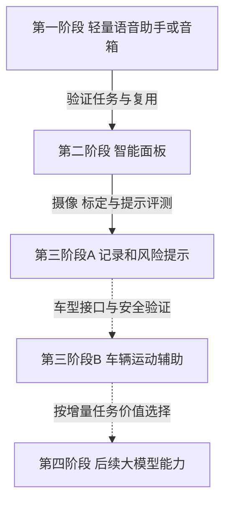
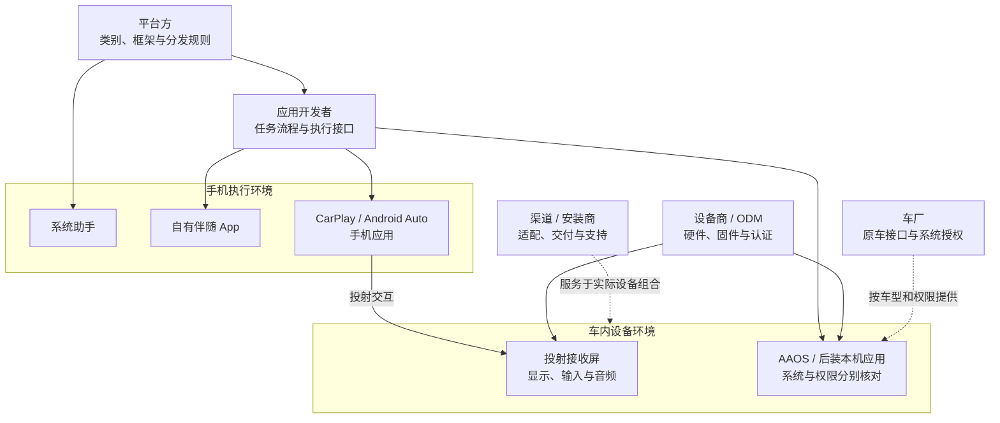
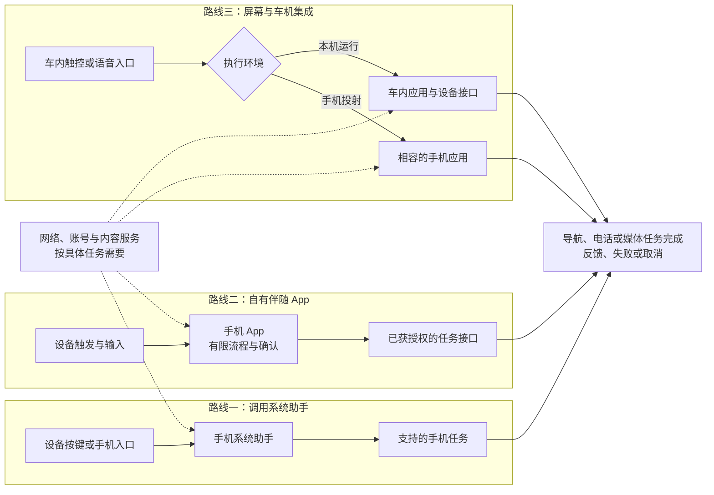
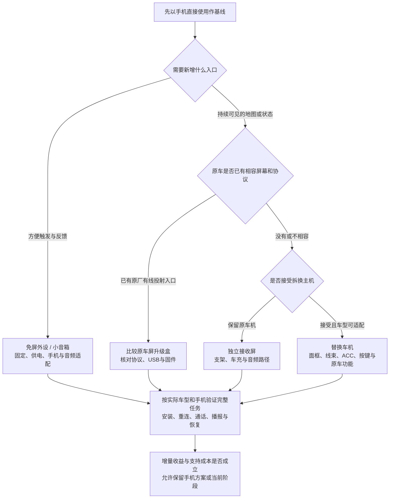
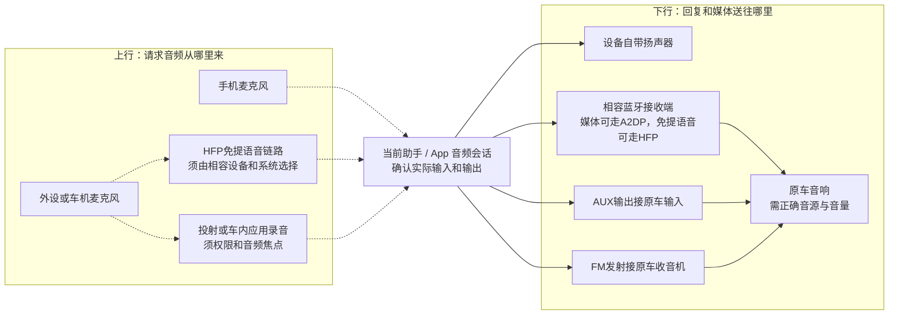
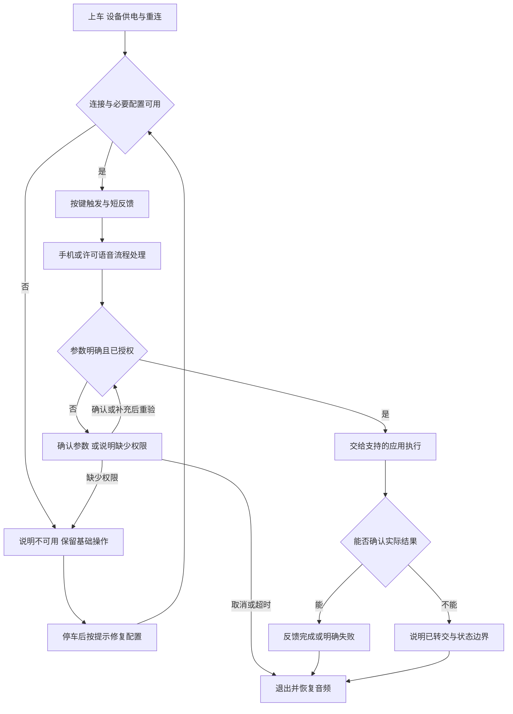
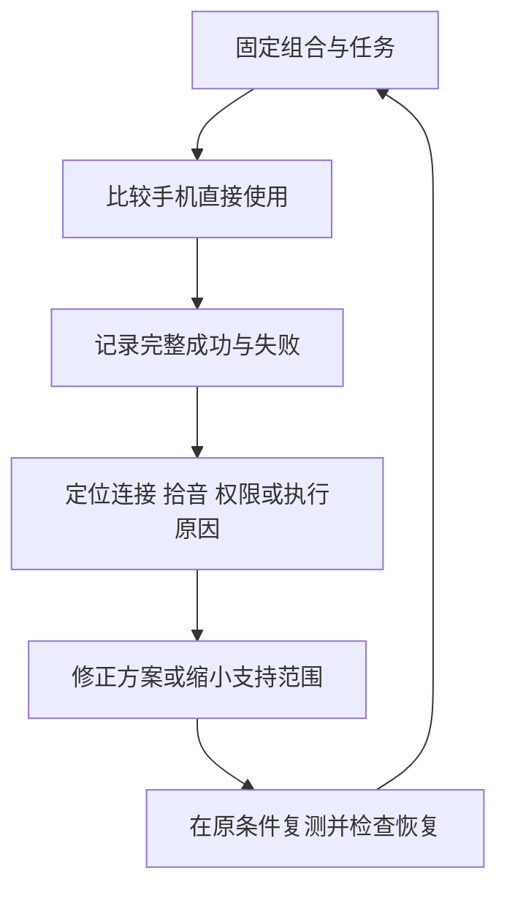
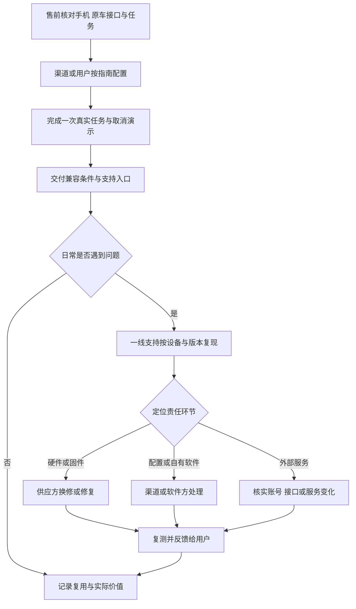
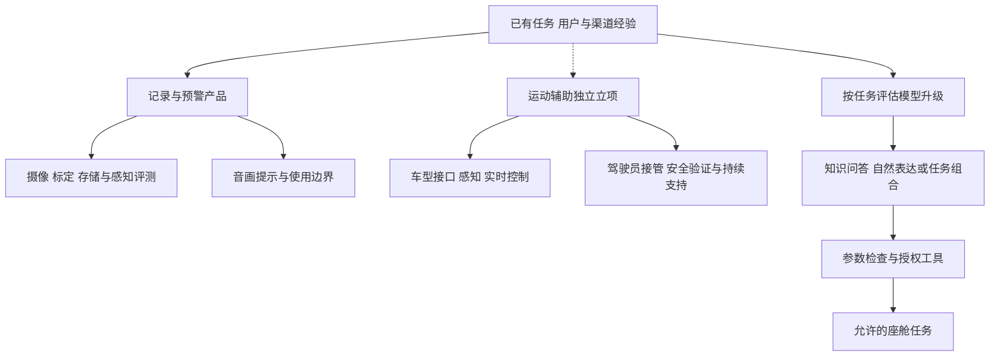

整理日期：2026年11月5日。面向 DreamSoul 的产品与经营判断，以存量燃油车的轻量智能化为起点，研究小型语音外设、智能面板、辅助驾驶及后续大模型能力。资料采用官方产品页、手册、平台文档和原始业务披露的针对性阅读，未进行采购、手机激活或实车测试。

**首款产品可以先是一件免屏、免拆的小外设：让少量车内高频任务更容易完成，语音识别和任务执行允许依赖手机、云服务或固定规则。** 蓝牙免提产品的官网已有当前销售线索，未验证采购交付。其公开价格和功能可作竞争参照。DreamSoul 需要验证的购买理由，是更少配置、更可靠的连接、明确的反馈，或针对某类用户更好完成任务。车内本地大模型可作为后续增量能力，首期价值应能独立成立。

# 一、产品起点与渐进路线
## （一）首款以少操作的任务入口建立购买理由
产品起点是免屏、免拆的小型语音助手或音箱，先让少量车内任务更容易完成。识别和执行可以依赖手机、云服务或固定规则，首款不要求车内运行通用大模型。Avantree CK11、Roadtrip 的官网提供当前价格、库存标签和手机助手入口说明，形成现实比较线索，采购交付尚未验证。这些材料说明已有类似供给，不能证明 DreamSoul 的目标需求或经营结果。[CK11 商品页](https://avantree.com/products/ck11-hands-free-bluetooth-for-car)、[Roadtrip 商品页](https://avantree.com/products/roadtrip-handsfree-bluetooth-speaker-for-cars)

客户先按原车接口和实际困难划分。缺少蓝牙、AUX 的用户可能更需要自带扬声器，已有基础蓝牙的用户可能更需要触发与反馈，已有稳定 CarPlay 或 Android Auto 的用户则已有较完整入口。燃油类型无法代替这种细分。首期可研究“接受手机联网、希望免拆安装、尚无好用车内入口”的用户，但这仍是客群假设，需观察他们已有手机方案的不足。

购买理由应能与手机直接使用比较：上车后是否少配置，按键是否容易找到，能否听到明确结果，断网或来电后是否容易恢复。CK11 官方指南特别说明语音命令使用手机麦克风，因此外设有麦克风并不自动等于改善助手拾音。拾音增量需要在具体手机和设备组合上验证。[CK11 交互指南](https://avantree.com/pages/ck11-interactive-user-guide)

## （二）四阶段分别有目标与进入条件
图中是研究提出的产品扩展方向，第三阶段分为记录预警和车辆运动辅助。各箭头代表需要重新确认的能力与经营条件。

这不是技术上的强制同序。大模型可在前期出现明确需求时独立评估，记录提示也可以成为长期独立产品。前一阶段用户量、售出设备或渠道规模，都不能代替下一阶段的产品和技术证据。

| **扩展关系** | **可复用的资产** | **必须新增或重新验证** | **推进依据** |
|---|---|---|---|
| 轻量助手到面板 | 已验证任务、确认与取消规则、部分音频适配、客户问题和支持经验 | 显示交互、安装供电、系统与固件、触控回退。投射屏是否允许自有软件另核 | 固定地图、状态或确认确有增量价值，安装和售后负担可承担 |
| 面板到记录预警 | 适用的显示、电源、固定方式及渠道流程 | 摄像头位置、标定、视频存储、感知与误报漏报、数据管理 | 目标场景的记录或提示价值成立，限制能被理解 |
| 记录预警到运动辅助 | 经确认适用的安装、设备管理和服务流程 | 车型授权接口、实时控制、接管与失效处置、安全团队和持续验证 | 特定车型和功能范围明确，具备专业合作与交付条件 |
| 已有产品到模型能力 | 任务词表、合法知识、工具接口、故障分类和评测样例 | 模型与语音许可、算力或云费、语言评测、不确定输出控制和版本维护 | 相同任务下优于规则或现有助手，增量收益覆盖新增成本 |

复用应落实到具体资产。例如“会做蓝牙音频”只能减少一部分面板接入工作，不能证明已经会做车辆控制。支持数据可以帮助找出高频故障，经授权的道路数据和控制验证仍需另行取得。这一矩阵是工程和经营分析，不代表上述厂商提供了开放接口或合作承诺。

## （三）允许停留、合作和调整方向
每阶段都应回答三个问题：用户为什么购买，产品怎样稳定交付，实际净收入能否承担对应责任。若手机已满足需求，可以调整客群或服务。若面板增量不足，可以继续经营轻量外设。若进入驾驶辅助，专业合作可能比全部自研更合适。区域市场也按同一方法核验，波兰仅作客群、渠道、语言和交付条件待核的案例。

本研究不预设销量、BOM、期限或融资额。推进依据应来自实际任务完成、用户复用、供应报价、支持负担和现金需求，不能仅由路线图或旧车存量推导。

# 二、平台与载体
首款语音助手与第二阶段面板，需要分别选择任务执行、界面和音频的接入方式。判断一套方案，先标清三件事：**任务在哪里执行、交互界面在哪里、麦克风与声音经过哪里。** 同一辆燃油车可能只有收音机，也可能已有成熟手机互联；动力类型不足以确定产品入口。以下为截至2026年11月5日的资料核查与研究判断，未完成手机或实车测试。

## （一）手机助手、投射界面与车内系统各管什么
手机系统助手已有导航、电话和媒体等能力。首款小外设可以通过按键调用它，让手机负责理解和服务，外设负责固定入口、提示与相容音频。Avantree CK11就提供呼出手机助手的按钮。这条路线减少首期自建服务，但助手设置、支持语言、锁屏和账号条件仍由手机环境决定，产品要明确支持的组合。[Avantree CK11语音指南](https://support.avantree.com/hc/en-us/articles/50767188774937-How-to-Make-a-Call-by-Voice-Command)

自有伴随App是另一种控制程度：在手机内保存常用地点、设备配置，组织确认和取消，调用获准的导航、通话或媒体接口。它有利于形成一致流程，但“系统助手能做”不代表“自有App也能做”。应先核对每项执行接口、后台运行和音频权限。不要为了拥有自己的对话界面，先承担一套没有额外用户收益的识别、账号和云服务。

**CarPlay与Android Auto是手机应用进入相容车内界面的路径。** 它们不是向任意接收屏安装自有系统的通用接口。CarPlay应用经对应授权与iOS应用分发，当前类别也包含语音对话。Android Auto以手机应用和受支持类别为基础，车端展示面向驾驶的界面；实际车辆运行还要求可信安装来源。已有屏幕入口适合复用地图、媒体和交互生态，但不会自动取得原车全部功能。[Apple CarPlay开发入口](https://developer.apple.com/carplay/)、[Apple CarPlay指南](https://developer.apple.com/download/files/CarPlay-Developer-Guide.pdf)、[Android Auto概览](https://developer.android.com/training/cars/platforms/android-auto)

**AAOS是在车内硬件运行的汽车系统，GAS是车厂可另行授权集成的Google服务集合。** Google built-in是在AAOS基础上集成相应Google应用和服务的产品路线。AAOS与Android Auto还可同时存在：一台车内系统可以既运行本机应用，又接收手机投射。[AOSP平台定义](https://source.android.com/docs/automotive/start/what_automotive)、[AAOS应用概览](https://developer.android.com/training/cars/platforms/automotive-os)

普通后装“Android车机”必须按具体固件判断，不能仅凭商品名称认定AAOS、GAS或原厂车辆接口均可用。ATOTO S8 Gen4能运行本机应用，也提供手机互联，但它的DriveChat明确需要联网。能安装应用、可以离线听本地媒体和语音任务完全离线，是不同事实。[ATOTO S8 Gen4手册](https://www.atotodirect.com/en-gb/pages/manual-460-en)

下图用于区分执行位置与授权角色，箭头表示管理或接入关系，不代表车辆数据自动开放。分析示意，依据Apple、Google、AOSP与MFi资料。

## （二）三种接入路线，先比较控制程度和新增责任
| **路线** | **任务和界面** | **可以获得的价值** | **新增责任与限制** |
|---|---|---|---|
| 调用现有系统助手 | 手机执行，按键和声音交互 | 较快验证少量日常任务与固定入口 | 依赖手机助手行为，不能承诺任意自定义唤醒、流程和麦克风路由 |
| 自有手机伴随App | 手机运行自己的有限流程，按需联网 | 可统一常用配置、确认、故障反馈与设备管理 | 自行处理权限、服务接口、账号、后台与系统变化 |
| 屏幕与车机集成 | 手机投射，或设备本机应用，两者分别选 | 增加地图、任务状态和触控回退，扩大可整合服务 | 应用上屏/分发、显示交互、设备接口、启动与维护责任增加 |

三条路线可以组合，但不能把它们当成同一授权的自然升级。自有App可以先服务免屏外设，之后再增加合规的车内界面；也可以直接与已有Android设备商合作。第二阶段是否需要本机应用，取决于任务和系统整合收益，不能只由“想摆脱手机”决定。

下图把同一导航、电话或媒体任务画成三种执行路径，虚线代表按任务才需要的云服务。分析示意，不代表已实现的DreamSoul架构。

## （三）四类硬件载体，对应四种安装拓扑
| **载体** | **典型连接** | **适用车辆与代价** |
|---|---|---|
| 免屏外设/小音箱 | 固定、供电，连接手机；自带扬声器或接原车音响 | 不先要求原车有屏，重点验证触发、拾音、重连和音频 |
| 独立屏 | 支架和车充，连接手机，再选择原车音频路径 | 保留原车机。要核对视野、固定、供电和声音去向，后摄另增布线 |
| 替换车机 | 拆换主机，接常电、ACC、地线、扬声器及车型配件 | 增加本机应用与整合能力，也承担面框、原车功放、按键和线束适配 |
| 原车屏升级盒 | 接原车已有相容投射协议的数据USB口 | 复用屏幕与音响，但不能仅凭USB口给完全无相容接口的车增加入口 |

W903说明独立屏可以采用配套车充、AUX/FM/蓝牙等声音路径；选装后摄需要布线。ATOTO手册则明确常电与ACC接错会影响休眠和启动。Carlinkit Tbox UHD的产品条件要求原厂有线CarPlay或Android Auto，商城还列出后装主机及仅无线协议的排除项。这些是不同载体的实际边界，不能用一句“免拆即插即用”统称。[W903官网](https://carpuride.com/products/carpuride-w903-portable-smart-multimedia-dashboard-console-with-front-camera)、[ATOTO手册](https://www.atotodirect.com/en-gb/pages/manual-460-en)、[Carlinkit条件](https://www.carlinkit.com/uhd6225)、[Carlinkit商城条件](https://carlinkitmall.com/collections/wireless-carplay-adapter/products/carlinkit-tbox-uhd-android-13-carplay-ai-box-with-hdmi-output)

“免拆”只是安装特征。独立屏仍可能需要调整音源、管理外露线缆、处理原车断电后USB持续供电；替换车机也不能按屏幕大小就判断适配。渠道应先记录车辆现有接口与保留功能，再匹配设备和安装套餐。

下图按车辆条件选择载体，保留不新增硬件的手机基线，不把购买大屏作为必然终点。分析示意，适配判断仍需逐车型验证。

## （四）听得见音乐，不代表助手用对了麦克风
音频必须分成“下行播放”和“上行拾音”核查。手机、外设和原车可能各有麦克风，按下设备按钮只是激活，不足以证明请求音频来自设备。CK11官方故障排查还要求手机保持在附近、手机麦克风无遮挡，是核对实际输入的具体提醒。[Avantree CK11语音指南](https://support.avantree.com/hc/en-us/articles/50767188774937-How-to-Make-a-Call-by-Voice-Command)

| **链路** | **解决什么** | **不能由此推出什么** |
|---|---|---|
| HFP免提 | 手机与免提设备之间的语音连接、相关电话控制 | 系统助手或自有App必定使用外设麦克风，或与其他音源同时工作 |
| A2DP音频分发 | 将媒体等音频从源设备送至蓝牙接收端 | 已有反向麦克风通道。播放成功不能验证录音 |
| AUX输出至车机输入 | 把外设或手机的模拟声音送入原车音响 | 这条输出线能读取原车麦克风或控制车机音量 |
| FM发射至收音机 | 让无AUX的音响也能播放外设声音 | 已解决拾音、切换音源、频点干扰和当地使用条件 |

HFP与A2DP的职责见[Bluetooth HFP简介](https://www.bluetooth.com/specifications/specs/hands-free-profile-1-10/)和[Android蓝牙配置](https://developer.android.com/develop/connectivity/bluetooth/profiles)；AUX、FM是W903公开的实际输出方式，表中产品含义为分析判断。上述链路可按产品组合，不保证所有手机和车机同时支持。

应用还需协同音频焦点。Android车载麦克风API要求先获录音许可与音频焦点，失去焦点就停止录音。来电、音乐、导航与助手会改变当前会话，应测试从唤起、听取、播报到恢复音乐的全过程，而非只验一次配对或播放。[Google车载麦克风说明](https://developer.android.com/training/cars/apps/library/car-microphone)

下图展示输入候选与输出分支，虚线表示需系统选择和实测的可选路径。它是路由集合，不表示可同时占用全部麦克风和音源。

## （五）平台权限、分发和合作由谁承担
应用开发者负责任务接口和反馈，平台方管理应用类别与分发，设备商管理固件、驱动和配件，车厂决定原厂车辆接口，渠道承担相应安装和支持。代理销售、给App安装权限和取得系统集成权限不是一件事。

CarPlay硬件接收端涉及MFi技术；仅使用iOS支持的标准蓝牙配置的外设，不应自动套用同一项目要求。选择ODM或现成设备时，应明确谁负责具体型号认证、授权和更新，不能只检查品牌有没有连接iPhone的产品。[Apple MFi FAQ](https://mfi.apple.com/en/faqs)

车内原生软件也有权限层次。AAOS的部分系统特权需要OEM预装并明确授予，用户点击同意不能替代。VHAL是车厂可实现的属性接口，不是对所有应用开放的车控总线。Android Auto也有按权限提供的部分车辆读取API，不能反向推广成通用写入。首两阶段应优先使用可授权的导航、电话和媒体任务，后续车辆信息及运动控制再分别论证。[AAOS助手集成](https://source.android.com/docs/automotive/voice/voice_interaction_guide/integration_flows)、[VHAL定义](https://source.android.com/docs/automotive/vhal)、[Car Hardware API](https://developer.android.com/training/cars/apps/library/car-hardware-api)

## （六）首款如何选择，第二阶段如何承接
本轮建议先选定一个手机系统、少量已核接口和一种音频组合，用手机原有方案作基线，再比较免屏外设是否减少操作。现有助手已能满足任务时，优先验证按键、固定、重连和反馈；确有流程缺口再引入伴随App。用户需要持续看到路线、候选或状态时，才比较独立屏与车机集成的收益。

选择依据应是完整任务成功、误执行、需看手机次数、上车恢复和支持成本。外置麦克风若没有实际进入录音链路，就不能作为拾音改善卖点；增加屏幕后，任务状态、确认和取消要在语音与界面之间一致。可复用的是经过验证的任务和服务经验，每种新载体仍要验证安装、供电和软件维护。后续记录、预警、运动辅助及更强模型各有新条件，不由平台上屏或设备销量自动取得。

# 三、按阶段竞品比较
## （一）首期直接竞品与历史经验
以下价格均保留时间、地区和具体型号。当前商品页有库存标识仅说明可见销售状态，尚未下单确认交付，不能作为波兰含税、运费和售后的套餐报价。

| **产品与阶段** | **能力和依赖** | **价格及状态** | **对产品判断的价值** |
|---|---|---|---|
| Avantree CK11，小型免提音箱 | 遮阳板夹装、自带扬声器、手机蓝牙和手机助手 | 官网 titanium 当前 US$44.99，标 In Stock | 是免拆首款的直接参照。官方指南明确语音命令使用手机麦克风，不能据设备有麦克风宣传已改善助手拾音。[CK11 商品页](https://avantree.com/products/ck11-hands-free-bluetooth-for-car)、[CK11 指南](https://avantree.com/pages/ck11-interactive-user-guide) |
| Avantree Roadtrip，小音箱与 FM | 自带扬声器，支持将手机音频送入收音机，长按旋钮两秒调用手机助手 | 官网当前 US$64.99，标 In Stock | 通过安装、音频和操作入口形成价值。助手说明仍要求手机助手启用、蓝牙和网络条件。[Roadtrip 商品页](https://avantree.com/products/roadtrip-handsfree-bluetooth-speaker-for-cars)、[助手激活说明](https://support.avantree.com/hc/en-us/articles/38121800304793-Roadtrip-How-to-activate-the-voice-assistant-with-the-car-kit-Siri-Google-Assistant) |
| Echo Auto 第 2 代，历史语音入口 | 专用拾音和固定配件，经手机 Alexa App 接入服务与车内音响 | 2022年美国发布价 US$54.99。本轮美国购买框显示不可用，现价未取得 | 展示手机加专用外设的路径。历史价格、支持页保留和当日服务可用是三件事。[Amazon 发布公告](https://press.aboutamazon.com/2022/9/amazon-introduces-four-new-echo-devices-plus-upgrades-to-echo-studio-audio)、[美国商品页](https://www.amazon.com/dp/B09X27YPS1) |
| Garmin Speak Plus，历史组合产品 | 手机数据连接 Alexa，同时加入行车记录和风险提示 | 2018年公告建议零售价 US$229.99，当前供货未核 | 可观察语音与摄像任务的组合，其功能不证明可转向、制动或已经形成成功业务。[Garmin 发布公告](https://www.garmin.com/en-US/newsroom/press-release/automotive/2018-the-new-garmin-speak-plus-with-amazon-alexa-brings-amazon-alexa-to-a-vehicle-and-adds-a-built-in-dash-cam/) |

这些产品说明首期能够围绕硬件入口和手机能力构建，未证明新进入者有足够需求。比较时应把手机直接使用、普通免提设备和成熟投射平台一并纳入，考察从上车到完成任务的全过程。Roav VIVA、JBL Smartbase 等历史型号可用于补充形态和服务依赖，不能以历史发布信息代替当前采购证据。

## （二）后续阶段使用不同参照
第二阶段可比较 Carpuride W903 这类独立投射屏、ATOTO S8 Gen4 这类替换车机，以及 Ottocast、Carlinkit 原车屏升级盒。W903 默认 SKU 当前官网 US$219.99，主要说明固定屏与记录任务的组合。升级盒通常先要求相容有线手机互联接口，完全无屏的旧车无法直接套用这一入口。[W903 商品页](https://carpuride.com/products/carpuride-w903-portable-smart-multimedia-dashboard-console-with-front-camera)、[Carlinkit UHD 产品条件](https://www.carlinkit.com/uhd6225)

ATOTO 官方手册明确 DriveChat 处理命令和回答需要联网，不能因其运行 Android 就写成完整离线语音。由此可见，第二阶段的关键问题仍是任务和系统整合，不必先建设本地大模型。[ATOTO S8 Gen4 手册](https://www.atotodirect.com/en-gb/pages/manual-460-en)

第三阶段的参考应拆为 Garmin Dash Cam 等记录预警设备、Mobileye 历史后装预警系统，以及 comma 的车型适配运动辅助。Cerence 等企业语音或模型方案属于后续集成参考，开发板、PC 演示和预告产品另列，不能与现售小音箱混成同一采购价格榜。

# 四、首款小型语音助手功能与工程
## （一）先限制任务，再补全使用过程
候选任务可从常用地点导航、常用联系人通话、已有媒体控制中选择。Google 官方分别提供这些任务的 Android Auto 操作路径，构成现成能力基线，但不证明自有 App 或蓝牙按键自动取得相同权限。自有产品需要先确认执行接口，再决定支持范围。[Google 导航](https://support.google.com/androidauto/answer/6348322?hl=en)、[电话](https://support.google.com/androidauto/answer/6348066?hl=en)、[媒体](https://support.google.com/androidauto/answer/6348327?hl=en)

以“去公司”为例，首次停车配置时选择地图应用并保存地点，完成一次实际导航。日常上车后，设备恢复供电和连接，用户按键得到短提示，说出指令，系统确认必要参数并交给导航。若无法取得最终状态，只能提示请求已转交，不能把识别成功或应用打开称为导航完成。拨号则核对联系人与号码、音频和挂断后的恢复，媒体任务核对目标应用及实际播放状态。

以下为拟议任务闭环，提示和状态反馈以所选手机、应用及接口实际可取得的能力为限。

参数确认后仍需重新核查参数和所需权限。未取得权限时退出当前任务，停车后按所选手机的流程处理配置。

首期可优先使用按键和少量单轮命令，允许手机助手完成识别与执行。若需要自有流程，可用现成识别、规则和许可接口。长对话、长期记忆、多乘员识别和通用车控应按增量价值另行评估。

## （二）把工程职责分到实际可控的环节
| **环节** | **需要负责的结果** | **不能默认取得的条件** |
|---|---|---|
| 外设与固件 | 固定、供电、按钮、音量、静音、连接和可理解反馈 | 外设麦克风会被手机助手使用，系统助手支持任意按钮映射 |
| 手机与任务集成 | 权限配置、账号、应用转交、后台和锁屏恢复、状态观测 | 第三方应用具有系统助手全部能力，所有手机保持同一行为 |
| 语音或云组件 | 实际支持的语言、接口可用性、超时和费用、版本维护 | 服务一直在线，断网仍完成同一任务，供应商替产品承担任务结果 |
| 供应与支持 | 型号批次、固件、说明、故障复现、换修和升级 | 同名称商品的充电口、配件和行为始终相同 |

Roadtrip 官方说明需要手机助手启用、蓝牙连接与网络，并规定长按旋钮两秒调用。CK11 指南则明确语音命令使用手机麦克风。这些条件要求把通话拾音、助手拾音和音频播放分别验证，不能只做一次配对演示。[Roadtrip 助手说明](https://support.avantree.com/hc/en-us/articles/38121800304793-Roadtrip-How-to-activate-the-voice-assistant-with-the-car-kit-Siri-Google-Assistant)、[CK11 指南](https://avantree.com/pages/ck11-interactive-user-guide)

## （三）按失败原因验证完整任务
以下是建议的验证方法，尚未执行。先限定手机、系统、外设、固件、应用和原车音源组合，以手机直接使用为基线。随后按停车准备、日常上车、触发执行和中断恢复重复同一任务，记录噪声、位置、网络及是否需要看手机。

重点加入来电抢占、断网、未登录、重名联系人、重复按键和超时场景，检查会否误执行以及怎样取消。网络恢复后也要避免重复发起过期任务。对既有助手无法观测或改变的环节，记录边界并调整产品承诺。

可分别统计完整任务完成、连接可用、人工重试、错误执行和恢复结果。完整任务完成率以预先约定的全部尝试为分母，包含连接失败，另列可用状态下的执行结果，避免只展示识别成功率。样本和验收阈值由实际产品目标确定，现阶段没有识别率、续航或工期的项目实测结论。

# 五、商业、渠道与经营可行性
## （一）先明确卖什么，以及谁承担承诺
可比较硬件套餐、软件或集成授权、可选持续服务三种方式。硬件套餐交付设备和已验证任务，软件授权交付受约定接口与版本支持的能力，持续服务则需说明服务内容和期限。首期依赖手机已有助手可以减少建设范围，但外设本身无法保证手机账号、第三方内容和网络长期不变。Roadtrip 的官方助手说明就把手机配置、蓝牙和网络作为前提。[Roadtrip 助手说明](https://support.avantree.com/hc/en-us/articles/38121800304793-Roadtrip-How-to-activate-the-voice-assistant-with-the-car-kit-Siri-Google-Assistant)

以下是拟议的责任划分，具体承担方及费用需供应、授权和渠道合同确认，未取得已成交的分成条件。

| **参与者** | **交付或取得的价值** | **需要落实的成本与责任** |
|---|---|---|
| 设备制造或 ODM 方 | 硬件、固件、配件和供货 | 批次一致性、质量、固件升级、备件及换修，软件接口是否开放 |
| 产品或软件方 | 任务体验、适配、品牌和版本支持 | 手机测试、账号与数据安排、服务监测、问题定位、停服或变更处置 |
| 电商或汽配渠道 | 获客、展示、选型和销售 | 宣传准确性、佣金或进销差价、退换入口、客服及结算，避免超出支持范围销售 |
| 安装或配置服务方 | 固定、配对、音频选择和现场演示 | 服务收费、配置失败、重复上门、原车功能问题和记录留存 |
| 外部服务提供方 | 地图、媒体、识别或云能力 | 商用许可、按量或周期费用、账号和地区条件、更新及退出机制 |

收入分配要和工作对应。门店若只交货与实际完成配置、演示及一线售后，所需资源不同。软件授权也要明确按设备、用户、项目还是期间收费。未取得条款前，不预设渠道比例、持续订阅或交易佣金成立。

## （二）把用户配置和支持连成可交付流程
售前先识别手机、原车音频和用户任务。首次配置尽量在停车状态完成：固定供电、配对、选择音源、启用所需权限，再演示一次真实任务和取消。交付记录保留准确型号、固件、手机和服务版本，便于后续定位。CK11 官方指南列出配对、安装、重连和助手设置，这些步骤会形成支持工作，不能因产品免拆而省略。[CK11 交互指南](https://avantree.com/pages/ck11-interactive-user-guide)

图为建议的支持链。售后应区分损坏、接口不兼容、手机设置、网络和第三方服务问题，明确用户先找谁、如何升级处理。故障频繁的组合可缩小销售范围或暂缓推荐，不能仅靠增加客服解释维持过宽的兼容承诺。

## （三）统一口径计算贡献和阶段投入
硬件套餐可用下式整理单机贡献，所有变量采用同币种、同税务与服务期间。该式是经营分析框架，不含虚构报价。

$$C=P_{\mathrm{net}}-C_{\mathrm{device}}-C_{\mathrm{delivery}}-C_{\mathrm{support}}-C_{\mathrm{service}}$$

$P_{\mathrm{net}}$ 为扣税、渠道扣点和促销后实际到账净收入，预测也沿用这一口径。各成本为设备、交付、退换支持及对应期间的服务费用，渠道扣点不重复扣除。退款若已冲减收入，也避免再次作为损失扣减。云费用和预期支持成本使用相同服务期，不能用一次硬件收入覆盖未经估算的无限期承诺。

固定研发、模具、认证、人员和验证投入另算，库存、账期、备货及回款再决定现金需求。轻量外设先核供货和手机适配，面板增加显示、安装及固件维护，记录预警增加摄像与感知评测，运动辅助增加车型接口及安全体系。前期正贡献只能支持当前经营判断，不能自动覆盖后续投入。

区域渠道应取得真实客群、接口分布、交付和售后能力、采购与结算资料。波兰仅为待核案例，语言、当地服务和含税交付另行确认。硬件售出、激活、复用、付费和退货分别记录，再判断应扩大渠道、改善产品还是停止某种组合。

# 六、辅助驾驶和后续大模型演进
## （一）记录预警先形成自己的产品目标
记录、事件回看和风险提示可以成为独立业务。Garmin Dash Cam X110 手册列出记录、保存及驾驶提醒，也明确提示受安装、视野和工作条件影响，驾驶员仍负责驾驶。Mobileye 8 Connect 则提供专用摄像与预警参照，其说明同样不能用来宣称替代驾驶员控制。[Garmin X110 手册](https://www8.garmin.com/manuals/webhelp/GUID-93747543-12A8-453C-9896-32070F5B0710/EN-US/Dash_Cam_X110_OM_EN-US.pdf)、[Mobileye 8 Connect 手册](https://static.mobileye.com/manual/me8/Mobileye%208%20connect%20%E2%80%93%20User%20manual.pdf)

这一阶段新增摄像头位置与标定、视频存储、感知、提醒策略和误报漏报评测。自有面板可以复用部分显示与电源，但新摄像头仍需重新验证。夜间、逆光、遮挡和天气变化应进入计划，记录的连续性与提示的准确性分别评估。停车看护、远程查看和云存储按供电、网络及服务条件另列，不能把基础录像能力扩大为全部功能离线可用。

商业需求也要重算。Mobileye 于2024年宣布收缩后装解决方案业务，解释原厂 ADAS 普及压缩后装机会，且该业务近年未对盈利作正贡献，同时保留商用车原厂相关业务。这一反例要求按具体客群评估替代和付费，并不证明所有后装提示产品都没有机会。[Mobileye 后装业务公告](https://ir.mobileye.com/news-releases/news-release-details/mobileye-wind-down-aftermarket-solutions-unit)

## （二）运动辅助需要单独的系统与合作条件
涉及转向、加减速或制动时，产品进入不同工程范围。comma 官方支持表按车型、年份、配置和线束限定，安全文档要求驾驶员关注、可接管，并说明限幅与测试。这些约束说明，车辆运动辅助需要具体接口和功能边界，无法从“传统燃油车”或“新能源车”这一动力标签判断支持。[comma 车辆支持](https://docs.comma.ai/CARS/)、[comma 安全说明](https://docs.comma.ai/concepts/safety/)

下图为能力分工分析，三类系统各自处理不同任务。语音结果通过授权工具执行座舱任务，不能直接等同车辆运动决策。

自有团队可负责需求、用户界面、设备管理和支持，传感、控制、车型接入或验证可与专业伙伴分工。合作前需确认适配权利、修改与升级边界、故障处置、验证证据和持续支持。座舱用户及对话可帮助发现需求，经授权的同步道路数据、控制专业团队和安全资源仍需另行取得。

## （三）后续模型按具体增量选择部署位置
适合比较的增量包括更自然的表达、许可车主资料问答、受限任务组合和多模态理解。先与规则或现成助手完成同一任务比较，再考虑云 API、手机模型、车内模型或混合。若选择车内推理，才继续核算算力、内存、热管理、启动、语音链路、许可和更新。辅助驾驶本身可能已有感知模型，和引入通用 LLM 是两个问题。

Cerence CaLLM Edge 的原始公告可作为企业嵌入式模型集成参考，其模型与部署能力不等于可直接采购的后装整机。具体硬件、软件授权、移植、工具接口和支持条件都应另核。[Cerence 嵌入式模型公告](https://investors.cerence.com/news-events/press-releases/detail/114/cerence-introduces-pioneering-embedded-small-language-model-purpose-built-for-automotive)

模型引入后，确认、取消、超时和权限规则仍然有效。知识回答允许说明不确定，实际动作需验证参数与权限。模型演示、开发板可运行和客户计划装车分别标注成熟度，不能据此承诺量产、全离线或车辆控制。第四阶段作为后续选择保留，但无需等待完成运动辅助后才研究其有用任务。

# 七、参考资料
以下均于2026年11月5日访问。针对性阅读范围与边界如下，当前销售、价格和服务条件仍须在采购前复核。完整逐项产品记录见 [车载智能化 产品样本](<车载智能化 产品样本.json>)，阅读范围见 [来源索引](<来源索引.md>)。引用产品资料说明厂商功能及条件，不构成独立性能或业务效果验证。

| **责任方与资料** | **版本或日期** | **阅读范围与价值边界** |
|---|---|---|
| Avantree：[CK11 商品页](https://avantree.com/products/ck11-hands-free-bluetooth-for-car)、[交互指南](https://avantree.com/pages/ck11-interactive-user-guide)、[语音拨号](https://support.avantree.com/hc/en-us/articles/50767188774937-How-to-Make-a-Call-by-Voice-Command) | 商品页滚动，指南更新2026-10-30，拨号更新2026-10-05 | 具体 SKU、价与库存、安装、助手和麦克风依赖。未购机或验证锁屏路由 |
| Avantree：[Roadtrip 商品页](https://avantree.com/products/roadtrip-handsfree-bluetooth-speaker-for-cars)、[助手激活](https://support.avantree.com/hc/en-us/articles/38121800304793-Roadtrip-How-to-activate-the-voice-assistant-with-the-car-kit-Siri-Google-Assistant) | 商品页滚动，支持更新2026-09-03 | 当前价与库存、音箱/FM、按钮和手机前提。商品续航描述有差异，正文不采用统一续航承诺 |
| Amazon：[Echo Auto 第 2 代发布](https://press.aboutamazon.com/2022/9/amazon-introduces-four-new-echo-devices-plus-upgrades-to-echo-studio-audio)、[美国购买页](https://www.amazon.com/dp/B09X27YPS1) | 公告2022-09-28，购买页滚动 | 历史形态、依赖、发布价及当前购买框。未验证账户激活和当日全部服务 |
| Garmin：[Speak Plus 发布](https://www.garmin.com/en-US/newsroom/press-release/automotive/2018-the-new-garmin-speak-plus-with-amazon-alexa-brings-amazon-alexa-to-a-vehicle-and-adds-a-built-in-dash-cam/) | 2018-01-08 | 语音、摄像和预警组合及历史价格。当前供货与业务成效未知 |
| Apple：[CarPlay 概览](https://developer.apple.com/carplay/)、[开发指南](https://developer.apple.com/download/files/CarPlay-Developer-Guide.pdf)、[MFi FAQ](https://mfi.apple.com/en/faqs) | 概览和 FAQ 滚动，指南2026-10-13 | 平台位置、应用类别、语音与录音、硬件接收端条件。未取得具体应用审核或硬件授权 |
| Google：[Android Auto](https://developer.android.com/training/cars/platforms/android-auto)、[AAOS 概览](https://source.android.com/docs/automotive/start/what_automotive) | 页面更新2026-10-22、2026-09-30 | 手机投射、车内系统和 GAS 的区别。不能由此确认后装商品的认证或开放接口 |
| Google：[导航](https://support.google.com/androidauto/answer/6348322?hl=en)、[电话](https://support.google.com/androidauto/answer/6348066?hl=en)、[媒体](https://support.google.com/androidauto/answer/6348327?hl=en) | 滚动更新 | 平台现成任务与依赖。不是自有 App 权限保证 |
| Bluetooth SIG：[HFP 1.10 简介](https://www.bluetooth.com/specifications/specs/hands-free-profile-1-10/)，Google：[蓝牙配置](https://developer.android.com/develop/connectivity/bluetooth/profiles) | 规范版本1.10，开发页滚动 | 通话与音乐配置的区别。未深入协议全文或验证具体手机路由 |
| Carpuride：[W903 商品页](https://carpuride.com/products/carpuride-w903-portable-smart-multimedia-dashboard-console-with-front-camera) | 滚动更新 | 默认 SKU、价格、独立屏和相机任务。未证实可安装任意自有助手 |
| Carlinkit：[UHD 产品页](https://www.carlinkit.com/uhd6225)，ATOTO：[S8 Gen4 手册](https://www.atotodirect.com/en-gb/pages/manual-460-en) | 滚动更新，ATOTO 对应 S84G209P | 升级盒接口条件、DriveChat 联网和车机接线。不同地区配置不能互相套用 |
| Garmin：[X110 用户手册](https://www8.garmin.com/manuals/webhelp/GUID-93747543-12A8-453C-9896-32070F5B0710/EN-US/Dash_Cam_X110_OM_EN-US.pdf) | ©2024 | 安装、记录、驾驶提醒及限制。未取得当前可核官网价或实车效果 |
| Mobileye：[8 Connect 手册](https://static.mobileye.com/manual/me8/Mobileye%208%20connect%20%E2%80%93%20User%20manual.pdf)、[后装业务公告](https://ir.mobileye.com/news-releases/news-release-details/mobileye-wind-down-aftermarket-solutions-unit) | 手册未明示日期，公告2024-03-18 | 预警责任边界及业务收缩原因。历史支持资料不代表重新开放后装销售 |
| comma：[车辆支持](https://docs.comma.ai/CARS/)、[安全说明](https://docs.comma.ai/concepts/safety/) | 滚动更新 | 车型配置适配与驾驶员责任。未安装、刷写或进行道路验证 |

**仍需补充的决策证据**：首期客群与任务观察、候选手机和外设的实际音频路由、供应与软件授权报价、波兰渠道及服务资料、用户复用和售后数据，以及各后续阶段的独立投入条件。现有公开资料能支持分清形态、依赖和风险，尚不能给出需求规模、量产成本或投资回报结论。

## 平台补充资料与阅读范围
下列记录用于网页参考资料与图注。共同访问日为2026年11月5日，未标日期的网页不以访问日替代发布日期。图均为本研究分析示意。

| **资料** | **版本/日期** | **实际阅读范围与价值** |
|---|---|---|
| [Apple CarPlay开发入口](https://developer.apple.com/carplay/) | 滚动页，未标更新日 | Apps、entitlement入口、automaker apps，区分应用、接收端和车厂合作 |
| [Apple CarPlay指南](https://developer.apple.com/download/files/CarPlay-Developer-Guide.pdf) | 2026-10-13 | 复核项目已保存官方PDF提取文本的类别、entitlement与App Store发布段落。本次网页重取因文件过大失败，未声称全文重读 |
| [Android Auto概览](https://developer.android.com/training/cars/platforms/android-auto) | 滚动文档 | 手机执行、类别、启动其他App、trusted stores，说明投射与分发边界 |
| [AOSP平台定义](https://source.android.com/docs/automotive/start/what_automotive) | 2026-09-30更新 | Android Auto/AAOS差异和GAS可选择授权，避免混淆系统名称 |
| [AAOS应用概览](https://developer.android.com/training/cars/platforms/automotive-os) | 2026-10-22更新 | Google built-in、与投射共存、应用差异，区分车内原生环境 |
| [Apple MFi FAQ](https://mfi.apple.com/en/faqs) | 滚动页 | 技术清单、标准蓝牙例外、开发/ODM/品牌/销售角色，说明责任不能互换 |
| [AAOS助手集成](https://source.android.com/docs/automotive/voice/voice_interaction_guide/integration_flows) | 2026-09-24更新 | 触发、系统特权和预装更新，证明原厂集成需要OEM参与 |
| [VHAL定义](https://source.android.com/docs/automotive/vhal) | 2026-09-24更新 | 车厂实现属性及读写/订阅抽象，不推断具体车辆已有权限 |
| [Car Hardware API](https://developer.android.com/training/cars/apps/library/car-hardware-api) | 2026-09-08更新 | CarInfo权限、数据可用性及车型依赖，避免绝对声称投射不能读车辆信息 |
| [Google车载麦克风](https://developer.android.com/training/cars/apps/library/car-microphone) | 2026-09-08更新 | 录音许可、焦点及失焦停止，支撑会话协作边界 |
| [Bluetooth HFP简介](https://www.bluetooth.com/specifications/specs/hands-free-profile-1-10/) | HFP 1.10，Adopted | 仅阅读规范简介的免提控制与语音连接，未声称研读完整协议或验证产品合规 |
| [Android蓝牙配置](https://developer.android.com/develop/connectivity/bluetooth/profiles) | 2026-10-23更新 | Headset/HFP与A2DP职责，不将平台API例子当目标手机兼容证明 |
| [CK11语音指南](https://support.avantree.com/hc/en-us/articles/50767188774937-How-to-Make-a-Call-by-Voice-Command) | 2026-10-05更新 | 手机助手呼出、设置及手机麦克风排查，只用于具体型号的入口与反例 |
| [W903官网](https://carpuride.com/products/carpuride-w903-portable-smart-multimedia-dashboard-console-with-front-camera) | 滚动商品页 | 复用本轮已读的供电、音频、手机投射和后摄布线正文，未更新价格判断 |
| [ATOTO S8 Gen4手册](https://www.atotodirect.com/en-gb/pages/manual-460-en) | 滚动手册 | 复用已读接口、DriveChat联网、休眠和方向盘适配段落 |
| [Carlinkit条件](https://www.carlinkit.com/uhd6225)及[商城条件](https://carlinkitmall.com/collections/wireless-carplay-adapter/products/carlinkit-tbox-uhd-android-13-carplay-ai-box-with-hdmi-output) | 滚动页面 | 复用已读的原厂有线协议、USB与排除项，不套用到其他盒子型号 |
